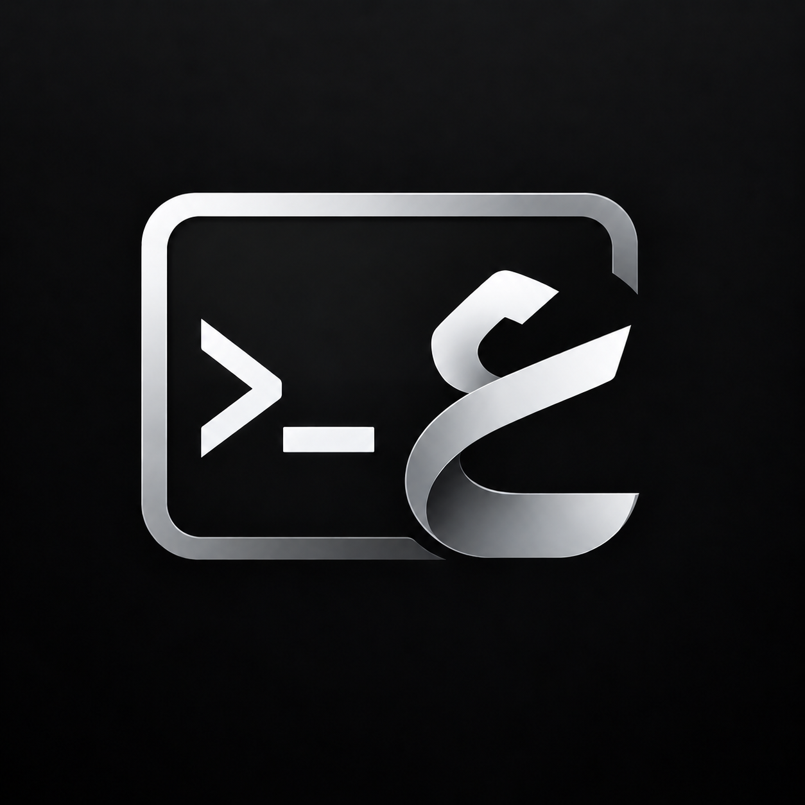
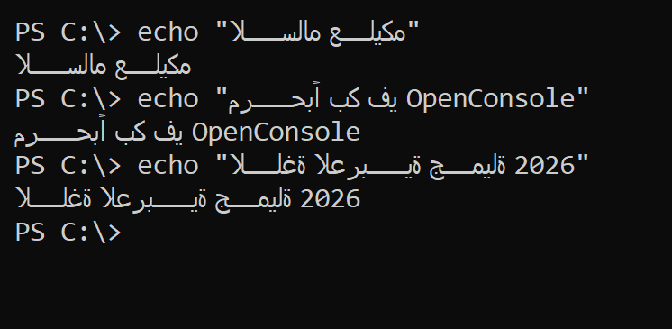
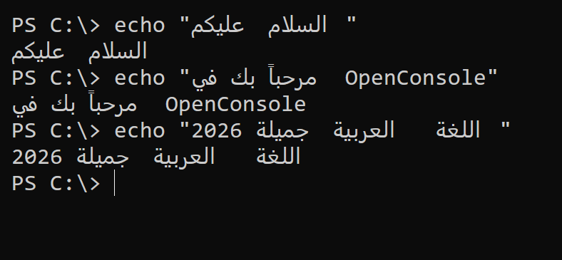
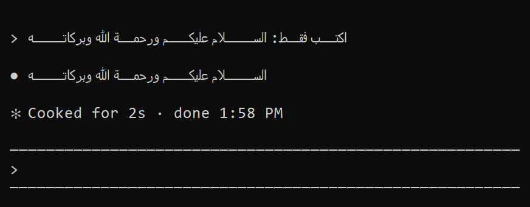
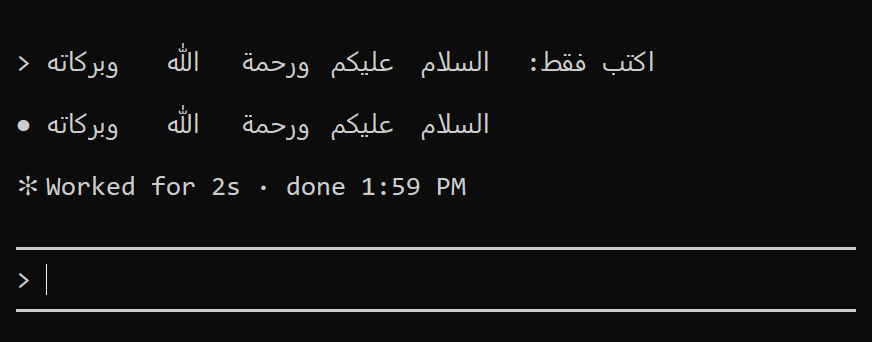
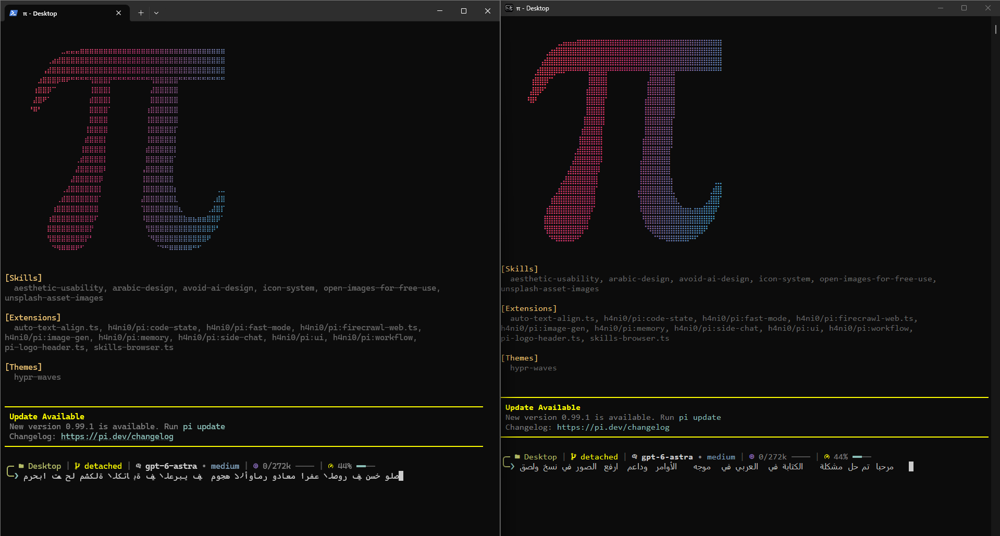
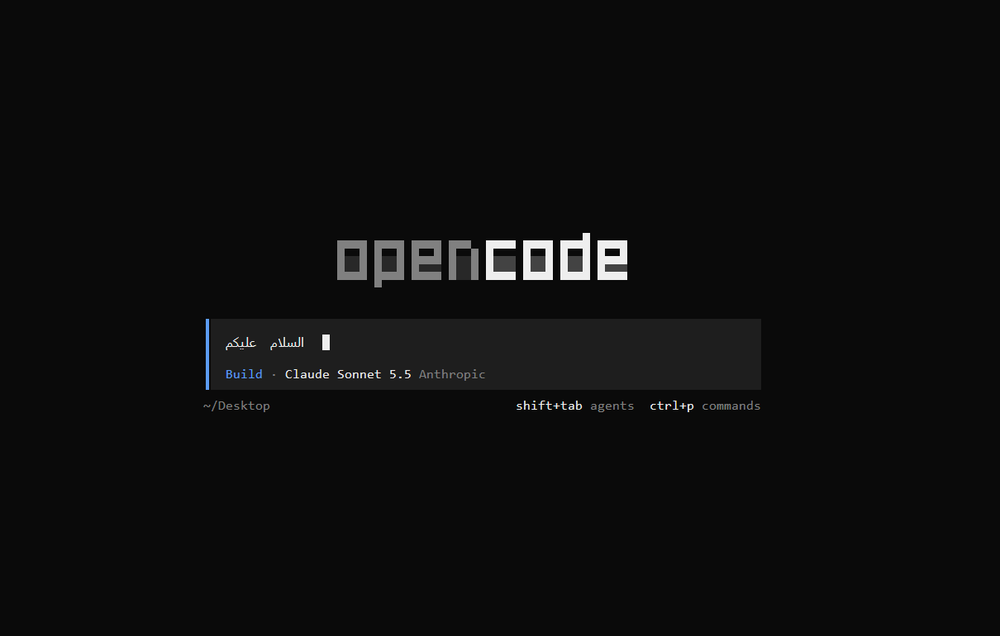

<p align="center">
  
</p>

<h1 align="center">OpenConsole</h1>

<p align="center">
  طرفية ويندوز تدعم <b>العربية والعبرية</b> أخيراً:<br>
  حروف متصلة، واتجاه من اليمين إلى اليسار، وتشكيل، وأسطر تجمع العربي والإنجليزي.
</p>

<p align="center">
  <a href="README.md">English</a> · <b>العربية</b>
</p>

<p align="center">
  <a href="#التثبيت">التثبيت</a> ·
  <a href="#قبل-وبعد">قبل وبعد</a> ·
  <a href="#المزايا">المزايا</a> ·
  <a href="#الإعدادات">الإعدادات</a> ·
  <a href="#حل-المشاكل">حل المشاكل</a> ·
  <a href="#كيف-يعمل">كيف يعمل</a> ·
  <a href="#القيود-المعروفة">القيود</a>
</p>

<p align="center">
  <a href="../../releases/latest/download/OpenConsole-x64.zip"></a>
</p>

<p align="center" dir="rtl">
  حمّل الملف، فُكّ ضغطه، واضغط مرتين على <b>Install.cmd</b>. هذا كل شيء.<br>
  <sub>Windows 11 x64 · بدون Visual Studio وبدون Git وبدون صلاحيات مدير</sub>
</p>

<p align="center" dir="rtl">
  مبني على <a href="https://github.com/microsoft/terminal"><b>microsoft/terminal</b></a> ·
  يعمل مع <a href="https://github.com/earendil-works/pi">pi</a> و<a href="https://opencode.ai">opencode</a> و<a href="https://code.claude.com/docs">Claude Code</a>
</p>

---

<div dir="rtl" align="right">

طرفية ويندوز ترسم كل حرف في خانة مستقلة وبالترتيب من اليسار إلى اليمين فقط. والنتيجة مع العربية: حروف غير متصلة وكلمات
تظهر معكوسة.

**OpenConsole** نسخة معدّلة (fork) من مشروع مايكروسوفت المفتوح المصدر
([`microsoft/terminal`](https://github.com/microsoft/terminal)، وهو المشروع الذي يبني `OpenConsole.exe`). علّمنا فيها محرك
رسم النص (DirectX) أن يعرض النص من اليمين إلى اليسار بشكل صحيح، وأصلحنا مشاكل لوحة المفاتيح واللصق مع اللغات غير الإنجليزية،
وأضفنا مثبّتاً يعمل بضغطتين.

يُستعمل مع وكلاء البرمجة في الطرفية مثل [pi](https://github.com/earendil-works/pi) و[opencode](https://opencode.ai)
و[Claude Code](https://code.claude.com/docs)؛ وكلها موضّحة في [قبل وبعد](#قبل-وبعد).

## المحتويات

- [قبل وبعد](#قبل-وبعد): [PowerShell](#powershell)، [Claude Code](#claude-code)، [pi](#pi)، [opencode](#opencode)
- [المزايا](#المزايا)
- [التثبيت](#التثبيت)
- [الاستخدام](#الاستخدام): [التشغيل](#التشغيل)، [قائمة الزر الأيمن](#قائمة-الزر-الأيمن)، [اختصارك الخاص](#اختصارك-الخاص)، [لوحة المفاتيح واللصق](#لوحة-المفاتيح-واللصق)، [لصق لقطات الشاشة](#لصق-لقطات-الشاشة)
- [استعمالها داخل VS Code](#استعمالها-داخل-vs-code): [التبويب](#استعمالها-داخل-vs-code)، [نافذة الطرفية من VS Code](#نافذة-الطرفية-من-vs-code)
- [الإعدادات](#الإعدادات)
- [حل المشاكل](#حل-المشاكل)
- [كيف يعمل](#كيف-يعمل)
- [للمطورين](#للمطورين)
- [القيود المعروفة](#القيود-المعروفة)
- [العلاقة بمشروع مايكروسوفت والترخيص](#العلاقة-بمشروع-مايكروسوفت-والترخيص)

</div>

## قبل وبعد

<div dir="rtl" align="right">

الأوامر نفسها وحجم النافذة نفسه والخط نفسه (Consolas). على اليسار: طرفية ويندوز الأصلية (`conhost.exe` في Windows 11). على اليمين: OpenConsole.

</div>

### PowerShell

| الأصلي | OpenConsole |
| :---: | :---: |
|  |  |

### Claude Code

<div dir="rtl" align="right">

أدوات مثل [Claude Code](https://code.claude.com/docs) ترتّب النص العربي بنفسها، لأنها تفترض أن الطرفية لا تفعل ذلك.
OpenConsole يكتشف هذا ويكتفي بوصل الحروف بدل ترتيبها مرة ثانية.

</div>

| الأصلي | OpenConsole |
| :---: | :---: |
|  |  |

### pi

<div dir="rtl" align="right">

[pi](https://github.com/earendil-works/pi) وكيل برمجة يعمل داخل الطرفية. هو مثال واحد من أمثلة كثيرة: OpenConsole ليس مصنوعاً
لأجل pi ويعامله مثل أي برنامج آخر. هذا هو pi نفسه والجملة العربية نفسها مكتوبة في مربع الإدخال. على اليسار: Windows Terminal.
على اليمين: OpenConsole. شكل pi في هذه اللقطة مأخوذ من [h4ni0/pi](https://github.com/h4ni0/pi).

</div>



<div dir="rtl" align="right">

- **Windows Terminal (يسار)** يرسم الحروف من اليسار إلى اليمين، فتخرج الكلمات والجملة كلها معكوسة.
- **OpenConsole (يمين)** يبدأ الجملة من اليمين، ويصل الحروف، ويُبقي الكلمات بالترتيب الصحيح.
- الأيقونات الصغيرة في شريط حالة pi (المجلد، فرع git، النموذج وغيرها) رموز من Nerd Fonts. عند ضبط [`IconFont`](#الأيقونات) يرسمها
  OpenConsole ويبقى النص بخطه العادي.
- pi يكتب ما تكتبه بترتيب القراءة، فالوضع العادي هو الصحيح ولا حاجة لضبط شيء. وفي
  [برامج ترتب النص بنفسها](#برامج-ترتب-النص-بنفسها) تنبيه عن إضافة لـ pi ترتّب العربية بنفسها.
- الكتلة الظاهرة بجانب النص هي مؤشر pi نفسه: مسافة معكوسة الألوان يرسمها pi بعد آخر حرف. يتركها OpenConsole في الخانة التي وضعها
  فيها pi، وهي في الجملة العربية على اليمين بجانب أول كلمة. انظر [القيود المعروفة](#القيود-المعروفة).

</div>

### opencode

<div dir="rtl" align="right">

[opencode](https://opencode.ai) وكيل برمجة مفتوح المصدر يعمل داخل الطرفية. هذه شاشة البداية فيه داخل OpenConsole، وقد كُتبت جملة
عربية في مربع الإدخال: الحروف متصلة والكلمات بالترتيب الصحيح.

</div>



<div dir="rtl" align="right">

## المزايا

### النص العربي والعبري

- **حروف عربية متصلة.** يُشكَّل النص بـ DirectWrite على أنه من اليمين إلى اليسار، فيأخذ كل حرف شكله (أول الكلمة أو وسطها أو آخرها)، وتعمل ألف اللام المدمجة (ﻻ).
- **ترتيب صحيح (خوارزمية Unicode للاتجاهين).** مقاطع اليمين إلى اليسار تنعكس داخل الأعمدة التي تشغلها، وباقي السطر يبقى مكانه. الأرقام والكلمات اللاتينية والأقواس داخل النص العربي تتبع القواعد المعيارية.
- **التشكيل** يبقى على حرفه.
- **العبرية** تمر بالمسار نفسه من الكود.
- **الجداول والواجهات النصية تبقى سليمة.** رموز رسم الإطارات تنهي المقطع، فلا تنقلب أعمدة الجدول.
- **المؤشر يتبع النص.** مؤشر الخط العمودي يقف في مكان الإدخال داخل الكلمة العربية، لا في طرفها البعيد.
- **الأسطر التي لا فيها حروف من اليمين إلى اليسار تُرسم كما كانت تماماً**، فلا يدفع النص الإنجليزي أي ثمن.
- **برامج ترتّب النص بنفسها.** طالما يعمل `claude.exe` في النافذة، يتحول OpenConsole إلى وضع يحافظ على ترتيبه ويكتفي بتصحيح أشكال الحروف. يمكن إضافة برامج أخرى ([التفاصيل](#برامج-ترتب-النص-بنفسها)).
- **وكلاء البرمجة.** يعمل مع [pi](#pi) و[opencode](#opencode) وClaude Code. pi يكتب بترتيب القراءة ولا يحتاج إلى ضبط شيء؛ وClaude Code يُكتشف تلقائياً ([أمثلة](#قبل-وبعد)).

مخزن الطرفية ما زال يحفظ النص بترتيبه المنطقي مثل أي طرفية أخرى. لا شيء يتغير في البيانات، فقط في طريقة رسمها.

### لوحة المفاتيح والحافظة

- **اختصارات تعمل على لوحة المفاتيح العربية.** في التخطيط العربي (أو العبري أو الروسي...) تسلّم الطرفية الأصلية `Ctrl+V` إلى PowerShell على أنه الحرف «ر»، فلا يُلصق شيء ويظهر حرف زائد. OpenConsole يرسل نفس محرف التحكم الذي يرسله التخطيط الإنجليزي، فتعمل `Ctrl+V` و`Ctrl+C` وباقي اختصارات `Ctrl+حرف` بنفس الطريقة في كل تخطيط.
- **لصق يعمل في كل مكان.** `Ctrl+V` و`Ctrl+Shift+V` و`Shift+Insert` تلصق أيضاً داخل برامج مثل Claude Code أو vim التي تضع الطرفية في «وضع إدخال VT». يصل النص كنص عادي حتى في البرامج التي تستعمل بروتوكول لوحة المفاتيح kitty. (الطرفية الأصلية تلصق بـ `Ctrl+V` في سطر الأوامر العادي فقط، وتحوّل بعض المحارف الملصوقة مثل `-` إلى متتاليات تحكم في البرامج التي تستعمل ذلك البروتوكول.)
- **لصق لقطات الشاشة بـ `Ctrl+V`.** التقط لقطة (`Win+Shift+S` أو `Print Screen` أو «Copy image» في المتصفح) ثم اضغط `Ctrl+V`: يحفظ OpenConsole الصورة كملف PNG ويلصق مسارها، تماماً كما لو سحبت الملف وأفلتّه في النافذة. البرامج التي تقبل ملفات الصور بالمسار، مثل Claude Code، تلتقطها من هناك. التفاصيل في [لصق لقطات الشاشة](#لصق-لقطات-الشاشة).

### المظهر

- **شكل طرفية حديث.** شريط عنوان وأشرطة تمرير داكنة، ومؤشر بشكل خط عمودي، وخط Cascadia Mono (أو Consolas إن لم يكن مثبتاً)، وأيقونة OpenConsole.
- **أيقونات Nerd Fonts** في أشرطة الحالة لأدوات مثل `pi` وstarship وlazygit، دون المساس بالخط الأساسي ([الأيقونات](#الأيقونات)).

### داخل VS Code

- **تبويب OpenConsole في لوحة VS Code**، بالتخطيط نفسه للعربية والعبرية ([التفاصيل](#استعمالها-داخل-vs-code)).

### سهولة التثبيت

- **تثبيت سهل.** حمّل، فُكّ الضغط، اضغط مرتين. يضيف اختصاراً وبنداً في قائمة الزر الأيمن، ولا يحتاج صلاحيات مدير. و`Uninstall.cmd` يتراجع عن كل شيء.

## التثبيت

### الخيار الأول: التحميل (الأسهل)

</div>

<p align="center">
  <a href="../../releases/latest/download/OpenConsole-x64.zip"></a>
</p>

<div dir="rtl" align="right">

1. اضغط **Download** واحفظ الملف `OpenConsole-x64.zip` (نحو 1 ميغابايت).
2. اضغط عليه بالزر الأيمن واختر **Extract All**.
3. اضغط مرتين على **`Install.cmd`**.

بعدها شغّل **OpenConsole** من قائمة ابدأ أو من سطح المكتب. لا تحتاج شيئاً آخر: لا Visual Studio ولا Git ولا صلاحيات مدير.
يعمل على Windows 11 x64 (يُفترض أن يعمل على Windows 10 الإصدار 1903 فأحدث، لكنه لم يُجرَّب).

وإذا كان **Visual Studio Code** مثبتاً فإن `Install.cmd` يضيف أيضاً تبويب **OpenConsole** إلى لوحته: طرفية تعرض العربية بشكل صحيح
([التفاصيل](#استعمالها-داخل-vs-code)). نوافذ VS Code المفتوحة تحتاج إعادة تحميل مرة واحدة (`Ctrl+Shift+P` ثم *Developer: Reload Window*).
ولإضافة هذا التبويب وحده، أو لإضافته لاحقاً، اضغط مرتين على **`Install-VSCode.cmd`**.

> قد يعرض ويندوز رسالة **«Windows protected your PC»** لأن الملفات غير موقّعة رقمياً. اضغط **More info** ثم **Run anyway**.
> المثبّت هو السكربت المقروء `install.ps1`.

يحتوي الملف المضغوط على عشرة ملفات: `Install.cmd` و`install.ps1` و`Uninstall.cmd` و`OpenConsole.exe` و`Install-VSCode.cmd`
و`install-vscode.ps1` و`openconsole-terminal-<version>.vsix` (إضافة VS Code) و`README.txt` و`LICENSE` و`NOTICE.md`.
للتأكد من سلامة التحميل قارن بصمته مع الملف `OpenConsole-x64.zip.sha256` في صفحة الإصدارات:

</div>

```powershell
Get-FileHash .\OpenConsole-x64.zip -Algorithm SHA256
```

<div dir="rtl" align="right">

الإصدارات القديمة وملاحظاتها في [صفحة الإصدارات](../../releases).

### الخيار الثاني: البناء بنفسك

**تحتاج** إلى Windows 11 x64 و[Git](https://git-scm.com/) وأدوات **C++ build tools** من Visual Studio (النسخة 2026 مجرَّبة،
و2022 يُفترض أن تعمل). أدوات البناء (Build Tools) تكفي ولا حاجة إلى Visual Studio كاملاً. احسب نحو 7 غيغابايت من المساحة الحرة.
المثبّت يفحص الأدوات ويطبع الأمر الدقيق لأي شيء ناقص.

</div>

```powershell
git clone https://github.com/yousef0688/OpenConsole-Arabic-Terminal.git C:\src\openconsole
cd C:\src\openconsole
.\install.ps1
```

<div dir="rtl" align="right">

أو اضغط مرتين على **`install.cmd`**. أول بناء يأخذ بضع دقائق، والبناءات التالية ثوانٍ.

> انسخ المشروع إلى مسار **بدون مسافات** (مثل `C:\src\openconsole`). المسارات الطويلة والمسافات تزعج أدوات C++.

إذا كانت أدوات C++ غير موجودة يطلب منك المثبّت تشغيل:

</div>

```powershell
winget install --id Microsoft.VisualStudio.BuildTools --exact --override "--passive --wait --add Microsoft.VisualStudio.Workload.VCTools --includeRecommended"
```

<div dir="rtl" align="right">

### ماذا يفعل المثبت

الخياران يشغّلان `install.ps1` نفسه. من الكود المصدري يستعيد أولاً حزم NuGet، ويجلب [vcpkg](https://github.com/microsoft/vcpkg)
(في أول مرة فقط)، ويبني `OpenConsole.exe` (x64، Release). ثم، في الحالتين:

1. ينسخ `OpenConsole.exe` إلى `%LOCALAPPDATA%\Programs\OpenConsole`.
2. يفعّل محرك DirectX ويضبط Cascadia Mono (أو Consolas إن لم يكن مثبتاً) بحجم 12 ومؤشراً عمودياً **لهذا البرنامج فقط**. إعدادات الطرفية لباقي ويندوز لا تُمَس.
3. ينشئ اختصار **OpenConsole** على سطح المكتب وفي قائمة ابدأ.
4. يضيف **Open OpenConsole here** إلى قائمة الزر الأيمن للمجلدات ولخلفية المجلدات (وسطح المكتب أيضاً).
5. إذا كان Visual Studio Code مثبتاً يضيف إليه تبويب OpenConsole (ملف الإضافة `.vsix` الذي في الملف المضغوط؛ ومن الكود المصدري مرّر `-VSCode`). الخيار `-NoVSCode` يتخطى هذه الخطوة.

كل شيء لمستخدمك فقط. هذه القائمة الكاملة بما ينشئه، وبما تحذفه `Uninstall.cmd`:

| ماذا | أين |
| --- | --- |
| البرنامج | `%LOCALAPPDATA%\Programs\OpenConsole\OpenConsole.exe` |
| الاختصارات | `OpenConsole.lnk` على سطح المكتب وفي قائمة ابدأ |
| بنود الزر الأيمن | `HKCU\Software\Classes\Directory\shell\OpenConsole` و`HKCU\Software\Classes\Directory\Background\shell\OpenConsole` |
| الإعدادات | `HKCU\Console\OpenConsole` و`HKCU\Console\C:_Users_<you>_AppData_Local_Programs_OpenConsole_OpenConsole.exe` |
| تبويب VS Code | الإضافة `openconsole.openconsole-terminal` في `%USERPROFILE%\.vscode\extensions` (يضعها VS Code هناك) |

لا يُكتب شيء خارج ملف مستخدمك، ولا شيء في `HKLM`. الشيء الوحيد الآخر الذي ينشئه OpenConsole هو مجلد لقطات الشاشة الملصوقة
([التفاصيل](#لصق-لقطات-الشاشة))، ويتركه المزيل كما هو.

### خيارات المثبت

أعطها لـ `Install.cmd` (من الملف المضغوط) أو لـ `install.ps1`:

| الخيار | المعنى |
| --- | --- |
| `-FontName "Lucida Console"` | خط آخر ثابت العرض. اقرأ [اختيار الخط](#اختيار-الخط) أولاً. |
| `-FontSize 16` | حجم الخط بالنقاط (الافتراضي 12). |
| `-IconFont "CaskaydiaCove NFM"` | خط للأيقونات فقط (Nerd Font مثلاً). انظر [الأيقونات](#الأيقونات). |
| `-BidiMode 2` | فرض أحد أوضاع الاتجاه (0 أو 1 أو 2). اتركه إلا إذا كنت تعرف السبب: [مرجع القيم](#مرجع-القيم). |
| `-Shell pwsh.exe` | تشغيل PowerShell 7 (أو `cmd.exe`) بدل Windows PowerShell. المجرَّب هو `powershell.exe` فقط. |
| `-Name "My Console"` | اسم الاختصارات وبنود الزر الأيمن ومفتاح الإعدادات (الافتراضي `OpenConsole`). لا تغيّر اسم اختصار بعد التثبيت: ويندوز يبحث عن الإعدادات بهذا الاسم. |
| `-InstallDir C:\Tools\OpenConsole` | التثبيت في مكان آخر. |
| `-NoDesktopShortcut` و`-NoStartMenu` و`-NoContextMenu` | تخطّي تلك الأجزاء. |
| `-NoVSCode` | لا تضف تبويب OpenConsole إلى Visual Studio Code (ولا تحذفه مع `-Uninstall`). |
| `-VSCode` | (من المصدر فقط) ابنِ إضافة VS Code وثبّتها أيضاً. الملف المضغوط يثبّتها افتراضياً. يحتاج Node.js. |
| `-VSCodeExtensionsDir C:\path` | ثبّت إضافة VS Code في مجلد الإضافات هذا (VS Code محمول). |
| `-Launch` | فتح نافذة عند انتهاء التثبيت. |
| `-Uninstall` | حذف الاختصارات وبنود الزر الأيمن والإعدادات والبرنامج وتبويب VS Code. |
| `-Configuration Debug` | (من المصدر فقط) بناء نسخة Debug بدل Release. |
| `-SkipBuild` | (من المصدر فقط) تثبيت `OpenConsole.exe` المبني سابقاً دون بناء. |
| `-BuildOnly` | (من المصدر فقط) البناء فقط دون تثبيت. |

أمثلة:

</div>

```powershell
.\Install.cmd -FontSize 16                # خط أكبر (من الملف المضغوط)
.\install.ps1 -SkipBuild -FontSize 16     # نفس الشيء من المصدر دون إعادة بناء
.\install.ps1 -SkipBuild -IconFont "CaskaydiaCove NFM"
```

<div dir="rtl" align="right">

كل تشغيل للمثبّت يكتب الخط والحجم وخط الأيقونات من جديد ويستبدل الاختصارات، **فإعادة تشغيله هي أيضاً طريقة إعادة الضبط**
عندما يتغير إعداد بالخطأ.

### التحديث والإزالة

- **التحديث (من التحميل):** حمّل الملف الجديد وشغّل `Install.cmd` مرة ثانية. يعمل والنوافذ مفتوحة؛ تبقى تعمل بالنسخة القديمة حتى تغلقها.
- **التحديث (من المصدر):** `git pull` ثم `.\install.ps1`.
- **الإزالة:** اضغط مرتين على `Uninstall.cmd` (من الملف المضغوط)، أو شغّل `.\install.ps1 -Uninstall`. يزيل تبويب OpenConsole من VS Code أيضاً. إذا كانت نافذة ما تزال مفتوحة، أغلقها وشغّل المزيل مرة ثانية ليحذف آخر ملف.

## الاستخدام

### التشغيل

- من **قائمة ابدأ** أو **اختصار سطح المكتب**. يفتح PowerShell.
- من **قائمة الزر الأيمن** لمجلد، أو لخلفية مجلد، أو لسطح المكتب ([أدناه](#قائمة-الزر-الأيمن)).
- من **VS Code**، كتبويب في لوحته ([استعمالها داخل VS Code](#استعمالها-داخل-vs-code))، أو كنافذة مستقلة ([ملف تعريف](#نافذة-الطرفية-من-vs-code)).
- باختصار خاص بك لبرنامج آخر ([أدناه](#اختصارك-الخاص)).
- من أي سطر أوامر، مع البرنامج المطلوب تشغيله كوسيط:

</div>

```powershell
& "$env:LOCALAPPDATA\Programs\OpenConsole\OpenConsole.exe" powershell.exe
```

<div dir="rtl" align="right">

إعدادات النافذة المفتوحة بهذه الطريقة تأتي من المفتاح المسمّى باسم مسار الملف التنفيذي، أي المفتاح الثاني في الجدول أعلاه.

كل ما يعمل في طرفية ويندوز الكلاسيكية يعمل هنا: PowerShell وcmd وPython وNode.js وغيرها.

### قائمة الزر الأيمن

يضيف المثبّت **Open OpenConsole here** (الاسم يتبع الخيار `-Name`) بأيقونة OpenConsole في ثلاثة أماكن:

- عند الضغط بالزر الأيمن على **مجلد**،
- وعلى **خلفية مجلد فارغة** في المستكشف،
- وعلى **سطح المكتب**.

اختياره يفتح نافذة OpenConsole فيها PowerShell، والمجلد الحالي هو الذي ضغطت عليه. يعمل مع أسماء المجلدات التي فيها مسافات وحروف
عربية (جُرِّب بمجلد اسمه «مجلد تجريبي»).

- في **Windows 11** القائمة المختصرة الجديدة لا تعرض بنوداً كهذا. اضغط **Show more options** (أو `Shift+F10`) لترى القائمة الكاملة، وفيها البند.
- هو مخزَّن في `HKCU\Software\Classes\Directory\shell\OpenConsole` و`HKCU\Software\Classes\Directory\Background\shell\OpenConsole`. الخيار `-NoContextMenu` يتخطاه و`Uninstall.cmd` يزيله.
- إذا أنشأت بنداً مشابهاً يدوياً سابقاً باسم آخر فسيبقى وسترى بندين. احذف المفتاح القديم باسمه تحت هذين المسارين.

### اختصارك الخاص

لتشغيل برنامج آخر في OpenConsole، مثل `claude.exe`، اصنع اختصاراً هدفه `OpenConsole.exe` ووسائطه البرنامج. **يبحث ويندوز عن إعدادات
الطرفية باسم الاختصار**، والاختصار الجديد لا إعدادات له: بدونها يُستعمل المحرك القديم ويبدو العربي خاطئاً (معكوساً وغير متصل). لذلك
انسخ إعدادات الاختصار المثبَّت إلى اسم الاختصار الجديد:

</div>

```powershell
$exe = Join-Path $env:LOCALAPPDATA 'Programs\OpenConsole\OpenConsole.exe'
$name = 'Claude in OpenConsole'                       # اسم الاختصار بدون ".lnk"
$link = (New-Object -ComObject WScript.Shell).CreateShortcut("$([Environment]::GetFolderPath('Desktop'))\$name.lnk")
$link.TargetPath = $exe
$link.Arguments = 'claude.exe'                        # البرنامج المطلوب تشغيله
$link.IconLocation = "$exe,0"
$link.Save()
Copy-Item 'HKCU:\Console\OpenConsole' "HKCU:\Console\$name" -Recurse
```

<div dir="rtl" align="right">

لا تغيّر اسم الاختصار بعد ذلك وإلا لم تُوجد الإعدادات. و`claude.exe` لا يحتاج `BidiMode`: يُعرف باسمه
([التفاصيل](#برامج-ترتب-النص-بنفسها)). جُرِّب هذا باختصار بلا إعدادات (خرج العربي معكوساً) ثم بعد نسخها (صحيحاً).

### لوحة المفاتيح واللصق

| المفاتيح | الفعل |
| --- | --- |
| `Ctrl+V` و`Ctrl+Shift+V` و`Shift+Insert` | لصق. يعمل أيضاً في البرامج التي تحوّل الطرفية إلى وضع إدخال VT (Claude Code وvim ...). ويعمل على كل تخطيط لوحة مفاتيح. |
| `Ctrl+حرف` (مثل `Ctrl+C` و`Ctrl+L`) | محرف التحكم نفسه في كل تخطيط لوحة مفاتيح. |
| تحديد بالفأرة ثم `Enter` أو نقرة يمنى | نسخ، كما في الطرفية الكلاسيكية (وضع QuickEdit). |

لتسليم اختصارات اللصق للبرنامج نفسه، مثلاً وضع التحديد المربع في vim على `Ctrl+V`، اضبط قيمة الطرفية القياسية
`CtrlKeyShortcutsDisabled = 1` ([مرجع القيم](#مرجع-القيم)).

### لصق لقطات الشاشة

1. التقط لقطة شاشة: `Win+Shift+S` أو `Print Screen` أو **Copy image** في المتصفح.
2. اضغط `Ctrl+V` في OpenConsole.

تُحفظ الصورة باسم `%TEMP%\OpenConsole\clipboard-YYYYMMDD-HHMMSS-mmm.png` ويُلصق المسار (بين علامتي اقتباس إن كان فيه مسافة)،
وهو النص نفسه الذي تحصل عليه بسحب الملف إلى النافذة. البرنامج الذي يقرأ ملفات الصور من المسار، مثل Claude Code، يلتقطها من هناك.

- يحدث هذا فقط عندما تحتوي الحافظة على **صورة وحدها**. إذا كان فيها نص أو ملف أيضاً فيُلصق النص أو الملف كالمعتاد.
- الملفات الأقدم من سبعة أيام في ذلك المجلد تُحذف في المرة التالية التي تلصق فيها لقطة.
- يُستعمل تنسيق PNG كما هو عندما يوفره المصدر، وإلا تُحوَّل الصورة النقطية بمكوّن الصور في ويندوز (WIC). لا يُرسل شيء إلى أي مكان.
- الصورة **لا** تصل إلى البرنامج كبكسلات. البرامج التي لا تستطيع قراءة ملف من مسار لا تستفيد من هذه الميزة.

## استعمالها داخل VS Code

طرفية VS Code (xterm.js) فيها المشكلة نفسها التي كانت في طرفية ويندوز القديمة: الحروف غير متصلة والعبارات تُقرأ معكوسة.
المجلد [`vscode-extension`](vscode-extension) فيه إضافة تضيف تبويب **OpenConsole** إلى لوحة VS Code بجانب *Terminal*. تشغّل PowerShell (أو
صدفة أخرى) في وحدة تحكم افتراضية، وترسم الأسطر التي فيها نص من اليمين إلى اليسار بالتخطيط نفسه الذي يستعمله محرك هذا المشروع: حروف
متصلة، وكلمات بالترتيب الصحيح، والمؤشر عند نهاية ما تكتبه، والوضع الخاص بالبرامج التي ترتّب النص بنفسها مثل Claude Code. ويمكن لصق
لقطات الشاشة بـ `Ctrl+V` أيضاً.

**التثبيت:** هي موجودة في التحميل نفسه. `Install.cmd` يضيفها إلى VS Code إذا وجده؛ ولإضافتها لاحقاً، أو لإضافتها وحدها، اضغط مرتين
على **`Install-VSCode.cmd`** (يجد VS Code Insiders أيضاً). ثم أعد تحميل نوافذ VS Code المفتوحة (`Ctrl+Shift+P` ثم *Developer: Reload Window*)
وافتح تبويب **OpenConsole** في اللوحة (`Ctrl+J`).

- **الإزالة:** `Install-VSCode.cmd -Uninstall`، أو `Uninstall.cmd` الذي يزيل كل شيء.
- **من الكود المصدري:** `.\install-vscode.ps1` يبني الإضافة (يحتاج Node.js وأدوات C++) ويثبّتها.
- **يدوياً**، بملف `.vsix` (وهو أيضاً في صفحة الإصدارات وحده): `code --install-extension openconsole-terminal-0.1.0.vsix`.
- **VS Code محمول:** `Install-VSCode.cmd -Cli C:\path\to\bin\code.cmd`.

طريقة البناء والإعدادات والقيود في [`vscode-extension/README.md`](vscode-extension/README.md). هي ليست الطرفية المدمجة: لا روابط
ولا تقسيم ولا تكامل مع الصدفة.

**لماذا إضافة وليس إعداداً؟** VS Code يرسم طرفيته بنفسه، فلا يستطيع `OpenConsole.exe` أن يرسم داخلها. إيقاف محرك GPU
(`terminal.integrated.gpuAcceleration` = `off`) أقرب إعداد: تتصل الحروف داخل الكلمة، لكن الكلمات تبقى من اليسار إلى اليمين،
وتخرج البرامج التي ترتّب النص بنفسها، مثل Claude Code، خاطئة. (جُرِّب مع xterm.js المرفق بـ VS Code 1.139.) الإضافة تعالج الأمرين.

### نافذة الطرفية من VS Code

إذا أردت نافذة الطرفية الحقيقية بدل التبويب فأضف ملف تعريف (profile) إلى `settings.json` في VS Code. يظهر في قائمة زر `+` في الطرفية،
ويفتح OpenConsole في نافذة عند المجلد المفتوح، ويغلق تبويبه الصغير فوراً:

</div>

```json
"terminal.integrated.profiles.windows": {
    "OpenConsole (new window)": {
        "path": "C:\\Windows\\System32\\WindowsPowerShell\\v1.0\\powershell.exe",
        "args": [
            "-NoProfile",
            "-Command",
            "Start-Process -FilePath (Join-Path $env:LOCALAPPDATA 'Programs\\OpenConsole\\OpenConsole.exe') -ArgumentList 'powershell.exe' -WorkingDirectory (Get-Location).Path"
        ],
        "icon": "link-external"
    }
}
```

<div dir="rtl" align="right">

يفترض مجلد التثبيت الافتراضي؛ غيّر المسار إذا استعملت `-InstallDir`. يفتح نافذة مستقلة، وليس تبويباً داخل اللوحة.

## الإعدادات

### أين تخزن الإعدادات

الإعدادات هي إعدادات الطرفية العادية في السجل (registry). ويندوز يبحث عنها بالاسم، ولذلك يكتبها المثبّت مرتين:

- `HKCU\Console\OpenConsole`: تُستعمل عند التشغيل من الاختصار (المفتاح يحمل اسم الاختصار بدون `.lnk`).
- `HKCU\Console\C:_Users_<you>_AppData_Local_Programs_OpenConsole_OpenConsole.exe`: يستعملها بند الزر الأيمن، وعند تشغيل الملف التنفيذي باليد (المسار مع كتابة كل `\` على شكل `_`).

أسهل طريقة لتغييرها أن تشغّل المثبّت مرة ثانية مع الخيار الذي تريده. أو عدّل القيم في **المفتاحين** (`regedit` أو PowerShell).
مثلاً لتغيير حجم الخط وخط الأيقونات للنسخة المثبتة:

</div>

```powershell
$exeKey = ($env:LOCALAPPDATA + '\Programs\OpenConsole\OpenConsole.exe').Replace('\', '_')
foreach ($k in 'OpenConsole', $exeKey) {
    $key = [Microsoft.Win32.Registry]::CurrentUser.CreateSubKey("Console\$k")
    $key.SetValue('FontSize', 14 * 0x10000, 'DWord')
    $key.SetValue('IconFont', 'CaskaydiaCove NFM', 'String')
    $key.Close()
}
```

<div dir="rtl" align="right">

التغييرات تسري على النوافذ التي تفتحها بعد ذلك.

> **ملف الاختصار قد يحمل نسخته الخاصة.** نافذة **Properties** لأي نافذة طرفية (زر أيمن على شريط العنوان) تسألك هل تطبّق
> التغيير على النافذة الحالية فقط، أم **تعدّل الاختصار**. الخيار الثاني يخزّن الخط والحجم والألوان وحجم النافذة *داخل ملف `.lnk`
> نفسه*، وتصير هذه النسخة هي المعتمدة قبل السجل. إذا بدت إعداداتك مُهملة، أو فتحت نافذة بحجم أو خط غريب، فهذا هو السبب المعتاد:
> شغّل المثبّت مرة ثانية فيستبدل الاختصارات. وللأمان اختر **النافذة الحالية فقط**.

### مرجع القيم

القيم `UseDx` و`BidiMode` و`IconFont` فقط خاصة بهذه النسخة. الباقي قيم طرفية قياسية يقرؤها هذا البرنامج أيضاً.

| القيمة | النوع | المعنى |
| --- | --- | --- |
| `UseDx` | DWORD | `1` = استعمل محرك DirectX. **مطلوب** لكل دعم العربية؛ محرك GDI القديم لم يتغير. |
| `BidiMode` (غير موجودة) | DWORD | تلقائي. يرتّب النص من اليمين إلى اليسار، إلا عندما يعمل في النافذة برنامج من [القائمة](#برامج-ترتب-النص-بنفسها). |
| `BidiMode = 0` | DWORD | لا معالجة للاتجاهين. يُرسم النص بترتيب التخزين، كالأصل. |
| `BidiMode = 1` | DWORD | رتّب النص من اليمين إلى اليسار دائماً. |
| `BidiMode = 2` | DWORD | البرنامج رتّب نصه بنفسه: احتفظ بالترتيب ووصّل الحروف فقط. |
| `IconFont` | String | خط يرسم الأيقونات فقط ([الأيقونات](#الأيقونات)). حتى 31 حرفاً. غير موجودة = لا شيء. |
| `FaceName` | String | الخط الأساسي. حتى 31 حرفاً. [اختيار الخط](#اختيار-الخط). |
| `FontSize` | DWORD | الحجم بالنقاط مضروباً في 65536: `0xC0000` يساوي 12 و`0xE0000` يساوي 14. |
| `FontWeight` و`FontFamily` | DWORD | `400` و`54` (TrueType ثابت العرض) هما ما يكتبه المثبّت. |
| `CursorType` | DWORD | `0` قديم، `1` خط عمودي، `2` شرطة سفلية، `3` مربع فارغ، `4` مربع ممتلئ، `5` شرطتان سفليتان. المثبّت يكتب `1`. |
| `WindowSize` | DWORD | الصفوف مضروبة في 65536 مضافاً إليها الأعمدة: `0x1E0078` تعني 120 عموداً و30 صفاً. |
| `CtrlKeyShortcutsDisabled` | DWORD | `1` = لا تعالج `Ctrl+V` وباقي اختصارات اللصق هنا؛ سلّمها للبرنامج. |

### اختيار الخط

استعمل خطاً **ليس فيه حروف عربية خاصة به**: Consolas أو Cascadia Mono أو Lucida Console. عندها يرسم ويندوز العربي بأحد خطوطه
العربية، فتتصل الكلمات وتنطبق على الخانات بشكل صحيح.

الخط الذي فيه حروف عربية (`CaskaydiaCove NFM` وهو Nerd Font لـ Cascadia Code، وCourier New كذلك) يُستعمل للنص العربي أيضاً.
مع `CaskaydiaCove NFM` تخرج الكلمات مضغوطة وخاطئة جزئياً: حروف تندمج أو تختفي. إذا ساء شكل العربي فجأة بعد تغيير الخط
فهذا أول ما يجب فحصه. أعد الخط كما كان، أو شغّل المثبّت مرة ثانية فيعيد الضبط.

إذا لم يكن Cascadia Mono مثبتاً يختار المثبّت Consolas، ويعود المحرك إلى Consolas لأي اسم خط لا يجده. أما كتابة قائمة خطوط مثل
`Consolas, CaskaydiaCove NFM` في `FaceName` فليست طريقة للحصول على الأيقونات: انظر القسم التالي.

### الأيقونات

برامج مثل `pi` وstarship وlazygit ترسم أيقونات برموز من مناطق الاستخدام الخاص في Unicode (من U+E000 إلى U+F8FF ومن U+F0000
إلى U+FFFFD). خط Consolas وباقي الخطوط العادية لا تحتويها، فتظهر على شكل معيّن فيه علامة استفهام. خط Nerd Font يحتويها، لكن جعله
الخط الأساسي يعيد المشكلة المذكورة أعلاه (حروفه العربية الخاصة).

اضبط `IconFont` على Nerd Font بدل ذلك. يبقى الخط الأساسي كما هو، ويُسأل خط الأيقونات **فقط** عن تلك المناطق، ولا يُسأل أبداً عن الحروف:

</div>

```powershell
.\install.ps1 -SkipBuild -IconFont "CaskaydiaCove NFM"
```

<div dir="rtl" align="right">

أو، لإعداد موجود، أضف القيمة النصية `IconFont` بجانب `FaceName` في المفتاح نفسه. استعمل النسخة `Mono` (`... NFM` أو
`... Nerd Font Mono`): أيقوناتها بعرض خانة واحدة. **لا** تكتب الخطين في `FaceName` هكذا `Consolas, CaskaydiaCove NFM`: قائمة
الخطوط تسري على كل محرف، فيُسأل الخط الثاني عن الحروف العربية أيضاً ويفسدها. (كما أن `FaceName` يتسع لـ 31 حرفاً فقط.)

يجب أن يكون الخط مثبتاً. إذا كان الاسم خاطئاً أو الخط غير موجود فلا يتعطل شيء؛ تبقى الأيقونات فقط على شكل معيّنات.

### برامج ترتب النص بنفسها

بعض البرامج تفترض طرفية بلا دعم للاتجاه من اليمين إلى اليسار، فتكتب نصاً مرتّباً مسبقاً. ترتيبه مرة ثانية يقلبه. تُعرف هذه
البرامج باسم ملفها التنفيذي في `visualBidiApps` داخل
[`src/interactivity/win32/window.cpp`](src/interactivity/win32/window.cpp):

</div>

```cpp
constexpr std::wstring_view visualBidiApps[] = { L"claude.exe" };
```

<div dir="rtl" align="right">

أضف اسماً، وأعد البناء، وأعد التثبيت. يتبدل الوضع للنافذة كلها طالما كان ذلك البرنامج متصلاً بها.

وإن أردت أن تقرر بنفسك فاضبط `BidiMode` في مفتاح إعدادات الاختصار (`HKCU\Console\<اسم الاختصار>`): القيمة `2` لاختصار لا
يشغّل إلا مثل هذا البرنامج، أو `1` لعدم التبديل أبداً.

[pi](#pi) ليس في هذه القائمة: فهو يكتب النص بترتيب القراءة، والوضع العادي يعرضه صحيحاً. أما إضافة لـ pi
تعيد ترتيب الكلمات العربية بنفسها، وقد صُنعت لطرفيات بلا دعم للاتجاه من اليمين إلى اليسار، فسيُعاد ترتيبها هنا مرة ثانية وتخرج
كلماتها بترتيب معكوس. عطّل مثل هذه الإضافة عند استعمال OpenConsole.

## حل المشاكل

| ما تراه | السبب | ما تفعله |
| --- | --- | --- |
| العربية تخرج معكوسة كما في صور «الأصلي» | محرك DirectX متوقف (`UseDx` غير موجودة). يحدث عندما تشغّل `OpenConsole.exe` لم يضبطه المثبّت، مثل نسخة في مجلد آخر. | شغّل الاختصار المثبت، أو شغّل المثبّت، أو اضبط `UseDx = 1` في المفتاح المطابق لاسم الاختصار أو لمسار الملف. |
| العربي يبدو مضغوطاً، والحروف تندمج أو تختفي | الخط الأساسي يحمل حروفاً عربية خاصة به (مثل `CaskaydiaCove NFM`). | أعد الخط إلى Consolas أو Cascadia Mono أو Lucida Console ([اختيار الخط](#اختيار-الخط)). |
| خطك أو حجمك أو ألوانك مُهمَلة، أو تفتح النافذة كبيرة جداً أو صغيرة جداً | ملف الاختصار يخزّن إعداداته ([الملاحظة أعلاه](#أين-تخزن-الإعدادات)). | شغّل المثبّت مرة ثانية. ومن الآن اختر **النافذة الحالية فقط** في Properties. |
| الأيقونات تظهر على شكل معيّن فيه علامة استفهام | الخط الأساسي لا يحتوي الأيقونات. | اضبط `IconFont` ([الأيقونات](#الأيقونات)). |
| أداة تطبع العربي معكوساً، أو معكوساً مرتين | الأداة ترتّب النص بنفسها، أو لا ترتّبه. | `BidiMode = 2` إن كانت ترتّبه، و`BidiMode = 1` إن لم تكن؛ أو أضفها إلى القائمة ([التفاصيل](#برامج-ترتب-النص-بنفسها)). |
| `Ctrl+V` لا يلصق شيئاً، أو يظهر حرف زائد | القيمة `CtrlKeyShortcutsDisabled` تساوي `1`، أو أن النافذة فُتحت قبل التغيير. | افتح نافذة جديدة وافحص القيمة. `Shift+Insert` و`Ctrl+Shift+V` بديلان مكافئان. |
| لقطة الشاشة لا تُلصق | الحافظة تحتوي أكثر من صورة (نصاً أو ملفاً أيضاً) فيُلصق ذلك بدلها. أو نُسخت الصورة بغير صيغة الصورة النقطية. | التقط اللقطة من جديد بـ `Win+Shift+S`. |
| «Windows protected your PC» | الملفات غير موقّعة رقمياً. | **More info** ثم **Run anyway**. |
| لا يوجد «Open OpenConsole here» في قائمة الزر الأيمن | في Windows 11 يكون عادةً في القائمة الكاملة. | اضغط **Show more options** أو `Shift+F10`. |
| بندان «Open ... here» في قائمة الزر الأيمن | بند قديم أُنشئ يدوياً باسم آخر. | احذف مفتاحه باسمه تحت `HKCU\Software\Classes\Directory\shell` و`...\Directory\Background\shell`. |
| اختصار صنعته بنفسي يعرض العربي معكوساً وغير متصل | يبحث ويندوز عن الإعدادات باسم الاختصار، والاختصار الجديد لا إعدادات له. | انسخ مفتاح إعدادات الاختصار المثبَّت إلى اسم الجديد ([اختصارك الخاص](#اختصارك-الخاص)). |
| لا يوجد تبويب OpenConsole في VS Code | VS Code يحمّل إضافاته عند بدء النافذة، أو لم يكن مثبتاً عندما شُغّل `Install.cmd`. | أعد تحميل النافذة (`Ctrl+Shift+P` ثم *Developer: Reload Window*)، أو اضغط مرتين على `Install-VSCode.cmd`. |
| يتوقف المثبّت برسالة «folder contains spaces» أو بأداة ناقصة | البناء من المصدر يحتاج مساراً بلا مسافات وأدوات C++. | اتبع الرسالة؛ تطبع الأمر الدقيق. |
| لقطات الشاشة تتراكم | تبقى في `%TEMP%\OpenConsole` حتى يمر عليها أسبوع. | احذف المجلد متى شئت. |

للبدء من الصفر: شغّل `Uninstall.cmd` ثم `Install.cmd`.

## كيف يعمل

التغيير كله في محرك رسم DirectX، [`src/renderer/atlas`](src/renderer/atlas)، وهو الذي يرسم الطرفية. باختصار:

1. السطر الذي فيه حروف من اليمين إلى اليسار يُحلَّل بـ `IDWriteTextAnalyzer::AnalyzeBidi` ويُقسم إلى مقاطع متساوية الاتجاه. الأسطر التي ليس فيها مثل هذه الحروف تأخذ مسار الكود الأصلي.
2. تُرتَّب المقاطع بترتيب العرض (القاعدة L2 من خوارزمية Unicode للاتجاهين) **داخل الأعمدة التي تشغلها**، فيبقى المؤشر والتحديد والألوان يعمل على الخانات المنطقية.
3. مقاطع اليمين إلى اليسار تُشكَّل على هذا الأساس، وهذا ما يصل الحروف؛ ثم تُعكس مجسّماتها (glyphs) للرسم.
4. لأن الحروف المتصلة يجب ألا تُفصل، يُطابَق النص العربي مع شبكة الأحرف كلمةً كلمة بدل حرفاً حرفاً.
5. يُحوَّل موضع المؤشر إلى داخل المقطع المعكوس.
6. في وضع «مرتَّب مسبقاً» (`BidiMode = 2`) يبقى الترتيب كما هو ويُكتفى بوصل الحروف.

حول المحرك:

- **اختيار الوضع.** النافذة تسأل في بداية كل إطار عن البرامج المتصلة بطرفيتها. طالما كان منها واحد من القائمة يتبدل الوضع وتُعاد رسم كل الصفوف.
- **الأيقونات.** قائمة الخطوط الاحتياطية التي يستعملها DirectWrite تأخذ ربطاً إضافياً واحداً، محصوراً في مناطق الاستخدام الخاص، يشير إلى `IconFont`. ويبقى الخط الاحتياطي للنظام خلفه.
- **لوحة المفاتيح.** `Ctrl+حرف` على تخطيط غير لاتيني يتحول إلى محرف التحكم الموافق لرمز المفتاح الافتراضي، وتُعالَج اختصارات اللصق قبل أن يراها البرنامج في وضع إدخال VT.
- **اللصق.** يُسلَّم النص محارف عادية بلا رموز مفاتيح افتراضية وبلا أحداث رفع مفتاح، فلا تستقبل البرامج التي تستعمل بروتوكول kitty متتاليات تحكم بدل `-` وأشباهها.
- **لقطات الشاشة.** تنسيق "PNG" في الحافظة يُكتب كما هو (طوله الدقيق يُعرف بالمرور على مقاطع PNG، لأن ذاكرة الحافظة مُبطَّنة)؛ والصور النقطية تُعاد إلى BMP في الذاكرة ثم يفكّها WIC ويرمّزها.

تفاصيل المحرك في [`src/renderer/atlas/README.md`](src/renderer/atlas/README.md).

## للمطورين

### البناء باليد

المثبّت يؤتمت هذا فقط (شغّله في *Developer PowerShell for VS*، أو بعد `vcvars64.bat`):

</div>

```powershell
dep\nuget\nuget.exe restore dep\nuget\packages.config
git clone --filter=blob:none https://github.com/microsoft/vcpkg dep\vcpkg
dep\vcpkg\bootstrap-vcpkg.bat -disableMetrics
msbuild src\host\exe\Host.EXE.vcxproj /p:Configuration=Release /p:Platform=x64 /p:SolutionDir=%CD%\ /m
```

<div dir="rtl" align="right">

الناتج هو `bin\x64\Release\OpenConsole.exe`. استعمل `/p:Configuration=Debug` لنسخة Debug (نحو 9 ميغابايت بدل نحو 1.3).
نسخة Release لا تستورد إلا مكتبات ويندوز، فلا تحتاج إلى أي runtime مثبت.

الملف التنفيذي الذي يعمل يمكن إعادة تسميته لكن لا يمكن الكتابة فوقه. إذا فشلت إعادة البناء عند الربط لأن نافذة ما زالت
مفتوحة، أعد تسمية الملف أولاً ثم ابنِ من جديد؛ المثبّت يفعل الشيء نفسه.

### ما الذي تغيّر مقارنة بكود مايكروسوفت

<details>
<summary>الملفات</summary>

| الملف | التغيير |
| --- | --- |
| `src/renderer/atlas/AtlasEngine.cpp` و`AtlasEngine.h` و`common.h` | تحليل الاتجاهين وإعادة الترتيب، التشكيل من اليمين إلى اليسار، مطابقة الشبكة كلمةً كلمة، تحويل موضع المؤشر، وضع «مرتَّب مسبقاً». |
| `src/renderer/atlas/AtlasEngine.api.cpp` | خط الأيقونات: خط احتياطي لمناطق الاستخدام الخاص فقط. |
| `src/renderer/atlas/DWriteTextAnalysis.cpp` و`.h` | يجمع مستويات الاتجاه من DirectWrite. |
| `src/interactivity/win32/window.cpp` | يختار الوضع بحسب البرامج العاملة في النافذة؛ ويسلّم خط الأيقونات للمحرك. |
| `src/interactivity/win32/Clipboard.cpp` | يلصق نصاً عادياً (بلا مفاتيح افتراضية وبلا أحداث رفع) في البرامج ذات وضع إدخال VT، ويلصق مسار PNG محفوظ عندما تحتوي الحافظة صورة. |
| `src/interactivity/win32/ClipboardImage.cpp` و`.hpp` | يحفظ صورة الحافظة كملف PNG (تنسيق "PNG" كما هو، أو DIB محوَّل بـ WIC). |
| `src/interactivity/win32/windowio.cpp` | اللصق بـ `Ctrl+V` و`Ctrl+Shift+V` و`Shift+Insert` في وضع إدخال VT أيضاً، ويبلّغ عن `Ctrl+حرف` كمحرف تحكم على تخطيطات لوحة المفاتيح غير اللاتينية. |
| `src/host/settings.cpp` و`settings.hpp` و`src/propslib/RegistrySerialization.cpp` | قيمتا السجل `BidiMode` و`IconFont`. |
| `src/internal/stubs.cpp` | شريط عنوان وأشرطة تمرير داكنة. |
| `src/host/res.rc` و`res/openconsole.ico` و`res/openconsole.png` | الأيقونة. |
| `install.ps1` و`install.cmd` و`uninstall.cmd` | المثبّت (يبني من المصدر، أو يثبّت الملف المحمَّل). |
| `install-vscode.ps1` و`install-vscode.cmd` | يضيف (أو يزيل) تبويب OpenConsole في Visual Studio Code: يجد VS Code ويثبّت ملف الإضافة. |
| `package.ps1` و`package/README.txt` | يبني `dist\OpenConsole-x64.zip`، وهو ملف التحميل للإصدارات (وفيه إضافة VS Code). |
| `vscode-extension/` | إضافة VS Code: تبويب طرفية OpenConsole بتخطيط اليمين إلى اليسار نفسه (JavaScript وxterm.js ومساعد صغير بلغة C++ لوحدة التحكم الافتراضية). |
| `README.md` و`README.ar.md` | الـ README الأصلي محفوظ باسم [`README.upstream.md`](README.upstream.md). |

</details>

### إضافة برنامج آخر يرتب نصه بنفسه

أضف اسم ملفه التنفيذي إلى `visualBidiApps` ([أعلاه](#برامج-ترتب-النص-بنفسها))، وأعد البناء، وأعد التثبيت.

### نشر إصدار

زر Download يشير إلى ملف آخر إصدار على GitHub، فلا بد من وجود إصدار:

</div>

```powershell
.\package.ps1                  # يبني الطرفية وإضافة VS Code ويكتب dist\OpenConsole-x64.zip وملف .sha256
.\package.ps1 -SkipBuild       # يضغط فقط ما بُني سابقاً
.\package.ps1 -SkipExtension   # ملف مضغوط بلا إضافة VS Code (لا يحتاج Node.js)
```

<div dir="rtl" align="right">

الملف المضغوط يحتوي إضافة VS Code ومثبّتها أصلاً. وملف الإضافة يُكتب أيضاً في `dist\` وحده. في GitHub افتح **Releases** واختر
**Draft a new release**، وأرفق الملف المضغوط وملف `.sha256` وملف `.vsix`، ثم انشر. أبقِ اسم الملف `OpenConsole-x64.zip` لأن الزر
يشير إلى `releases/latest/download/OpenConsole-x64.zip`. وبواسطة GitHub CLI:

</div>

```powershell
gh release create v1.0.0 dist\OpenConsole-x64.zip dist\OpenConsole-x64.zip.sha256 dist\openconsole-terminal-0.1.0.vsix --title "OpenConsole 1.0.0"
```

<div dir="rtl" align="right">

اختياري: لتمكين الناس من تثبيت الإضافة من عرض الإضافات في VS Code (بالبحث عن "OpenConsole") انشرها في Marketplace. أنشئ ناشراً
(publisher) في <https://marketplace.visualstudio.com/manage>، وضع معرّفه في `publisher` داخل `vscode-extension/package.json`، ثم شغّل
`npx @vscode/vsce publish` في ذلك المجلد (يطلب رمز وصول). والأمر `npx ovsx publish` يفعل الشيء نفسه في Open VSX، متجر VSCodium
ومحررات أخرى. لم أفعل هذا نيابةً عنك: يحتاج حساباتك.

</div>

<div dir="rtl" align="right">

### كيف جرى الفحص

فُحصت التغييرات بالبناء (Debug وRelease، x64) وبتشغيل الناتج: لقطات لنفس النص بالمحرك الأصلي والمعدَّل، وإدخال لوحة مفاتيح
وحافظة مُحقَن في نافذة خاصة، وبرنامج اختبار صغير يترجم `ClipboardImage.cpp` وحده ويحوّل صوراً نقطية اصطناعية (24 و32 بت، مع بايتات
الشفافية بصفر كما تتركها `Print Screen`، ولوحة ألوان، وأقنعة 5-6-5، ومن الأعلى إلى الأسفل). مشاريع اختبارات الوحدة الأصلية لم تُبنَ ولم
تُشغَّل لهذه التغييرات، ولا توجد اختبارات آلية لكود الطرفية الجديد بعد. إضافتها مساهمة مرحّب بها.

لإضافة VS Code 19 اختباراً آلياً (`npm test` في `vscode-extension`: تخطيط اليمين إلى اليسار، والمساعد الذي يشغّل وحدة التحكم الافتراضية،
والجلسات). وشُغّلت أيضاً في نسخة منفصلة من VS Code تُدار عبر منفذ التنقيح مع لقطات للوحة (`vscode-extension/test/e2e`): أسطر عربية،
وكتابة، وأسهم، ونسخ ولصق النص ولقطة الشاشة، وتغيير الحجم، وإعادة التشغيل، وخط الأيقونات، وبديل عن Claude Code، وملف `.vsix` المعبّأ
مثبّتاً في مجلد نظيف. وشُغّلت المثبّتات في مجلدات معزولة، بمكان تثبيت خاص ومجلد إضافات VS Code خاص.

## القيود المعروفة

- **الذي يُبنى ويُجرَّب هو نافذة الطرفية الكلاسيكية فقط** (`OpenConsole.exe`). تطبيق Windows Terminal (التبويبات واللوحات) لم يُبنَ. المحرك مشترك معه لكن هذا لم يُجرَّب، والتبديل التلقائي لـ `claude.exe` موجود في نافذة الطرفية فقط.
- جُرِّب على Windows 11 (x64) مع Visual Studio Build Tools 2026 وخط Consolas وبناءَي Debug وRelease وPowerShell وClaude Code 2.1.284 وpi 0.87.1 وopencode. لم يُجرَّب على Windows 10 ولا مع خطوط أخرى. العربية هي اللغة التي طُوّر بها واختُبر؛ والعبرية تمر بالكود نفسه.
- اتجاه السطر دائماً من اليسار إلى اليمين: السطر العربي يبدأ من الحافة اليسرى بدل أن يُحاذى إلى اليمين.
- تحديد *جزء* من كلمة عربية بالفأرة قد يظلل خانات لا تنطبق على الحروف.
- قد يقفز المؤشر إلى الطرف الآخر من الكلمة مباشرة بعد كتابة مسافة في نص عربي.
- المؤشر الذي يتبع النص هو مؤشر الطرفية نفسها فقط. البرنامج الذي يرسم مؤشره بنفسه، كما يفعل pi بمسافة معكوسة الألوان بعد آخر حرف، يقع مؤشره في الخانة التي بعد النص، وهي في الجملة العربية على اليمين بجانب أول كلمة (انظر لقطة [pi](#pi)).
- بعد أن يخرج برنامج من القائمة أعلاه، يُرسم ما كتبه في النافذة بالطريقة العادية ثانية وقد يبدو خاطئاً. الأمر `cls` يمسحه.
- الأيقونات: جُرِّب `CaskaydiaCove NFM` وحده كخط للأيقونات، وتغطي فقط مناطق الاستخدام الخاص. بعض الرموز التي تضعها Nerd Fonts خارجها (مثل رموز الطاقة عند U+23FB) ما تزال تأتي من الخطوط العادية.
- بند الزر الأيمن لا يعمل في المجلدات التي يحتوي اسمها على فاصلة عليا (`'`). وفي Windows 11 هو في القائمة الكاملة (**Show more options**) لا في القائمة المختصرة الجديدة.
- تبويب OpenConsole في VS Code ليس الطرفية المدمجة (لا روابط ولا تقسيم ولا تكامل مع الصدفة)، وتحديد *جزء* من مقطع عربي فيه يظلل أعمدة لا تنطبق على الحروف. قائمة قيوده الكاملة في [`vscode-extension/README.md`](vscode-extension/README.md).
- لصق الصورة يلصق مسار ملف، فيفيد فقط البرامج التي تقرأ ملفات الصور. الصورة لا تُرسل كبكسلات.
- لا يوجد شريط تبويبات: التبويبات من تطبيق Windows Terminal وليست من نافذة الطرفية.
- التحميل غير موقّع رقمياً، فينبّه SmartScreen في ويندوز مرة واحدة (انظر [التثبيت](#الخيار-الأول-التحميل-الأسهل)).

## العلاقة بمشروع مايكروسوفت والترخيص

OpenConsole نسخة معدّلة من [`microsoft/terminal`](https://github.com/microsoft/terminal)، مأخوذة من لقطة للكود بتاريخ
28 سبتمبر 2026 (الإيداع `0626dc145717313435965eb4f3b0aff5a4cd7df5`). الـ README الأصلي لمايكروسوفت محفوظ في
[`README.upstream.md`](README.upstream.md).

الترخيص [MIT](LICENSE) كالأصل. إشعارات الأطراف الثالثة في [`NOTICE.md`](NOTICE.md). وإضافة VS Code تضم أيضاً
[xterm.js](https://github.com/xtermjs/xterm.js) و[bidi-js](https://github.com/lojjic/bidi-js)، وكلاهما بترخيص MIT؛ تراخيصهما داخل
الإضافة (`media/vendor/LICENSES.txt`).

هذا المشروع غير تابع لمايكروسوفت ولا مدعوم منها. «Windows Terminal» و«Windows» و«Microsoft» علامات تجارية لشركة Microsoft Corporation.

طُوِّر التغيير بمساعدة مساعد ذكاء اصطناعي (Claude من Anthropic) وفُحص بالبناء والتشغيل. ولمشروع مايكروسوفت سياسته الخاصة
في المساهمات المدعومة بالذكاء الاصطناعي ([`AGENTS.md`](AGENTS.md))؛ اقرأها قبل أن ترسل أي جزء من هذا الكود إلى مشروعهم.

## المساهمة

المشاكل (Issues) وطلبات الدمج (Pull requests) مرحّب بها، خاصةً للغات أخرى تُكتب من اليمين إلى اليسار، وبرامج أخرى ترتّب
نصها بنفسها، والاختبارات الآلية، والقيود المذكورة أعلاه. أرفق لقطة شاشة لأي شيء مرئي، واذكر إصدار ويندوز والخط والبرنامج الذي استعملته.

</div>
