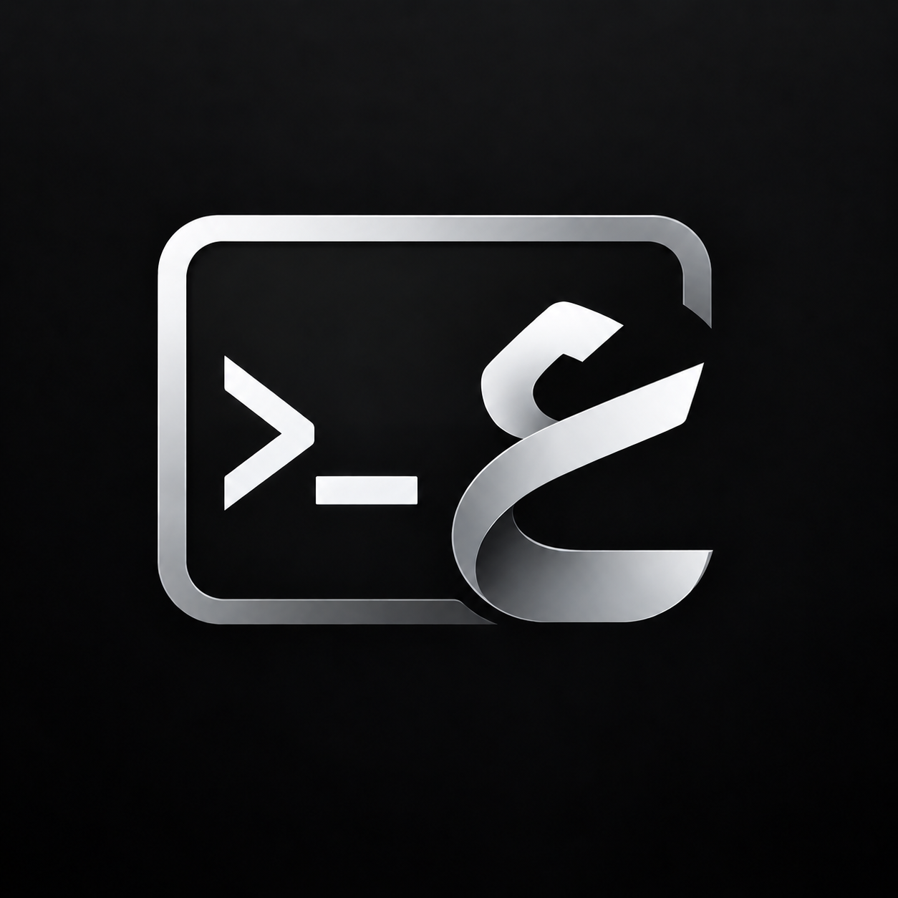
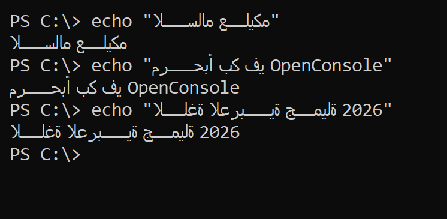
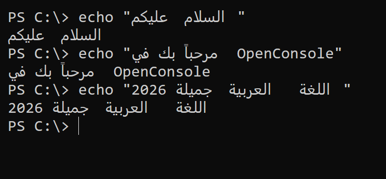
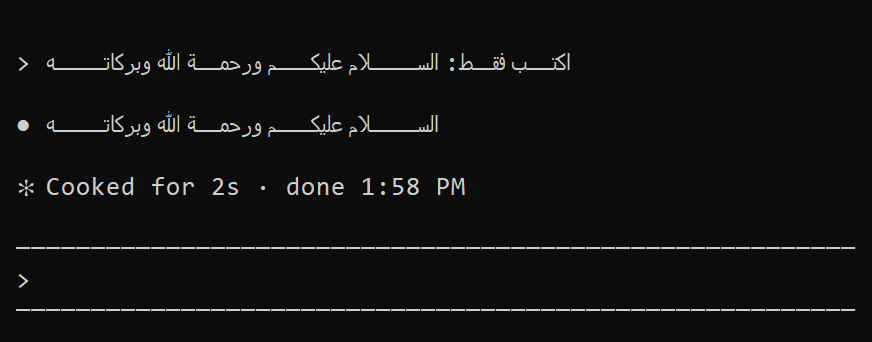
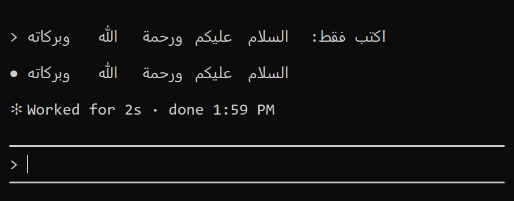
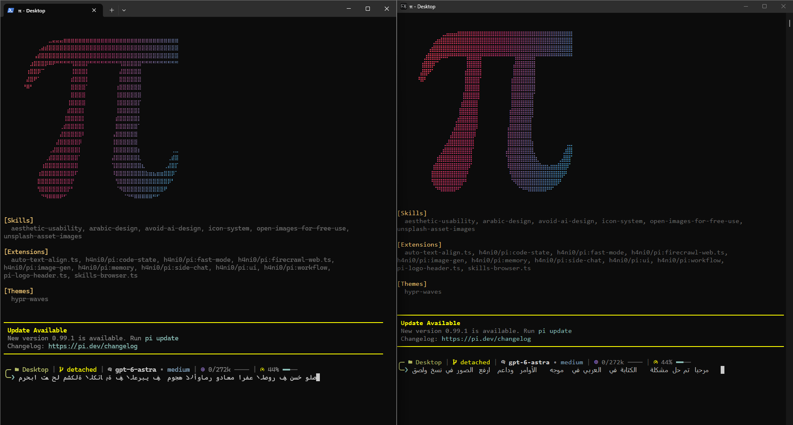
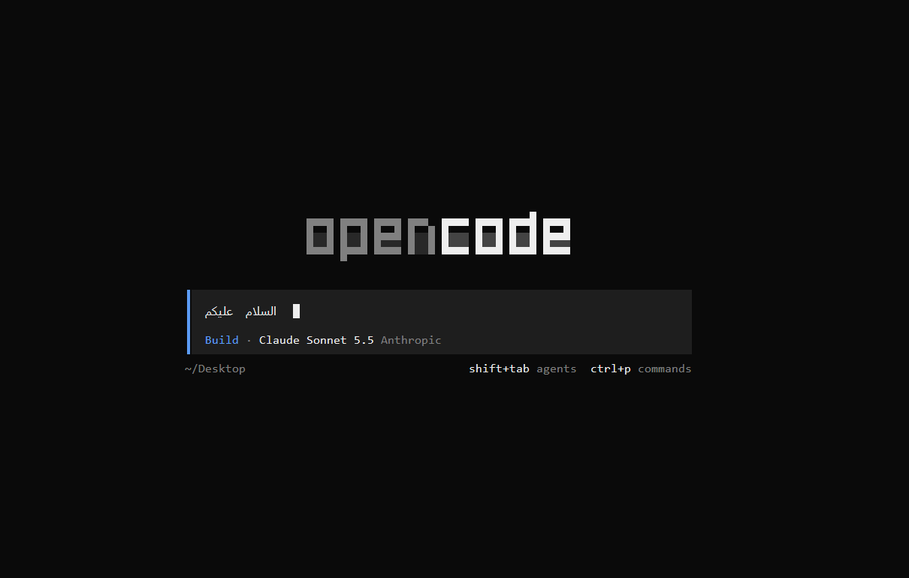

<p align="center">
  
</p>

<h1 align="center">OpenConsole</h1>

<p align="center">
  A Windows console that finally handles <b>Arabic and Hebrew</b> text:<br>
  connected letters, right-to-left order, diacritics, and mixed Arabic + English lines.
</p>

<p align="center">
  <b>English</b> · <a href="README.ar.md">العربية</a>
</p>

<p align="center">
  <a href="#install">Install</a> ·
  <a href="#before-and-after">Before / after</a> ·
  <a href="#features">Features</a> ·
  <a href="#configuration">Configuration</a> ·
  <a href="#troubleshooting">Troubleshooting</a> ·
  <a href="#how-it-works">How it works</a> ·
  <a href="#known-limitations">Limitations</a>
</p>

<p align="center">
  <a href="../../releases/latest/download/OpenConsole-x64.zip"></a>
</p>

<p align="center">
  Download, extract, double-click <b>Install.cmd</b>. That's it.<br>
  <sub>Windows 11 x64 · no Visual Studio, no Git, no administrator rights</sub>
</p>

<p align="center">
  Built on <a href="https://github.com/microsoft/terminal"><b>microsoft/terminal</b></a> ·
  works with <a href="https://github.com/earendil-works/pi">pi</a>, <a href="https://opencode.ai">opencode</a> and <a href="https://code.claude.com/docs">Claude Code</a>
</p>

---

The Windows console draws every character in its own cell, strictly from left to right. For Arabic that means letters
that do not connect and words that come out in reverse order.

**OpenConsole** is a fork of Microsoft's open-source console host
([`microsoft/terminal`](https://github.com/microsoft/terminal), the project that builds `OpenConsole.exe`). It teaches the
DirectX text renderer to lay out right-to-left text properly, fixes the keyboard and paste problems that come with a
non-English keyboard, and comes with a two-click installer.

It is used with terminal coding agents such as [pi](https://github.com/earendil-works/pi), [opencode](https://opencode.ai) and
[Claude Code](https://code.claude.com/docs); they are all shown [below](#before-and-after).

## Contents

- [Before and after](#before-and-after): [PowerShell](#powershell), [Claude Code](#claude-code), [pi](#pi), [opencode](#opencode)
- [Features](#features)
- [Install](#install): [download](#option-1-download-easiest), [build it yourself](#option-2-build-it-yourself), [what the installer changes](#what-the-installer-does), [options](#installer-options), [update and remove](#updating-and-removing)
- [Using OpenConsole](#using-openconsole): [starting it](#starting-it), [the right-click menu](#the-right-click-menu), [your own shortcut](#your-own-shortcut), [keyboard shortcuts](#keyboard-and-clipboard), [pasting screenshots](#pasting-screenshots)
- [Use it inside VS Code](#use-it-inside-vs-code): [the tab](#use-it-inside-vs-code), [the console window from VS Code](#the-console-window-from-vs-code)
- [Configuration](#configuration): [where settings live](#where-the-settings-live), [all values](#settings-reference), [fonts](#choosing-a-font), [icons](#icons-nerd-fonts), [programs that reorder text](#programs-that-reorder-text-themselves)
- [Troubleshooting](#troubleshooting)
- [How it works](#how-it-works)
- [For developers](#for-developers)
- [Known limitations](#known-limitations)
- [Relationship to Microsoft's project, license](#relationship-to-microsofts-project-license)

## Before and after

The same commands, the same window size and the same font (Consolas). Left: the original Windows console (`conhost.exe` of Windows 11). Right: OpenConsole.

### PowerShell

| Original | OpenConsole |
| :---: | :---: |
|  |  |

### Claude Code

Tools such as [Claude Code](https://code.claude.com/docs) reorder right-to-left text themselves, because they assume a
terminal that cannot. OpenConsole notices that and only joins the letters instead of reordering them a second time.

| Original | OpenConsole |
| :---: | :---: |
|  |  |

### pi

[pi](https://github.com/earendil-works/pi) is a coding agent that runs in the terminal. It is one example among many: OpenConsole is
not made for pi and treats it like any other program. Below is the same pi with the same Arabic sentence typed into its input box.
Left: Windows Terminal. Right: OpenConsole. The look of pi in this screenshot is taken from
[h4ni0/pi](https://github.com/h4ni0/pi).



- **Windows Terminal (left)** draws the letters from left to right, so every word and the sentence itself come out backwards.
- **OpenConsole (right)** starts the sentence on the right, joins the letters and keeps the words in the right order.
- The small icons in pi's status line (folder, git branch, model and more) are Nerd Font symbols. With
  [`IconFont`](#icons-nerd-fonts) set, OpenConsole draws them while the text keeps its normal font.
- pi writes what you type in reading order, so the normal mode is the right one and there is nothing to set. See
  [Programs that reorder text themselves](#programs-that-reorder-text-themselves) for a pi extension that reorders Arabic on its own.
- The block next to the text is pi's own cursor: an inverted space that pi draws after the last letter. OpenConsole leaves it
  in the cell where pi put it, which for an Arabic sentence is on the right, next to the first word. See
  [Known limitations](#known-limitations).

### opencode

[opencode](https://opencode.ai) is an open source coding agent that runs in the terminal. Here is its start screen in OpenConsole, with
an Arabic sentence typed into the prompt box: the letters are connected and the words are in the right order.



## Features

### Arabic and Hebrew text

- **Connected Arabic letters.** Text is shaped with DirectWrite as right-to-left, so every letter takes its initial, medial or final form, and lam-alef ligatures work.
- **Correct order (Unicode Bidirectional Algorithm).** Right-to-left runs are reversed inside the columns they occupy; everything else in the line stays where it is. Numbers, Latin words and brackets inside Arabic text follow the standard rules.
- **Diacritics (tashkeel)** stay on their letter.
- **Hebrew** goes through the same code path.
- **Tables and TUIs keep working.** Box-drawing characters end a bidi run, so the columns of a table are not swapped.
- **The cursor follows the text.** A bar cursor sits at the insertion point of a right-to-left word, not at the far end of it.
- **Lines without right-to-left text are drawn exactly as before**, so English output pays nothing for this.
- **Apps that reorder text themselves.** While `claude.exe` runs in a window, OpenConsole switches to a mode that keeps its order and only fixes the letter shapes. More programs can be added ([details](#programs-that-reorder-text-themselves)).
- **Coding agents.** Works with [pi](#pi), [opencode](#opencode) and Claude Code. pi writes in reading order and needs nothing set; Claude Code is detected automatically ([examples](#before-and-after)).

The console buffer still stores text in logical order, like every other console. Nothing about the data changes; only how it is drawn.

### Keyboard and paste

- **Shortcuts that work on an Arabic keyboard.** On an Arabic (or Hebrew, Russian, ...) layout the original console hands `Ctrl+V` to PowerShell as the letter "ر", so nothing is pasted and a stray letter appears. OpenConsole reports the same control character as on an English layout, so `Ctrl+V`, `Ctrl+C` and the other `Ctrl+letter` shortcuts behave the same in every layout.
- **Paste that works everywhere.** `Ctrl+V`, `Ctrl+Shift+V` and `Shift+Insert` paste also inside programs such as Claude Code or vim, which put the console in "VT input mode". The text arrives as plain text, even in programs that use the kitty keyboard protocol. (The original console pastes with `Ctrl+V` only in plain command lines, and turns some pasted characters, such as `-`, into escape sequences for programs with that protocol.)
- **Paste screenshots with `Ctrl+V`.** Take a screenshot (`Win+Shift+S`, `Print Screen`, or "Copy image" in a browser) and press `Ctrl+V`: OpenConsole saves the image as a PNG file and pastes its path, exactly as when you drag the file into the window. Programs that accept image files by path, such as Claude Code, pick it up from there. See [Pasting screenshots](#pasting-screenshots).

### Look

- **A terminal look.** Dark title bar and scroll bars, a bar cursor, Cascadia Mono (or Consolas when that is not installed), and the OpenConsole icon.
- **Icons from Nerd Fonts** in the status lines of tools such as `pi`, starship or lazygit, without touching the main font ([Icons](#icons-nerd-fonts)).

### Inside VS Code

- **An OpenConsole tab in the panel of VS Code**, with the same layout for Arabic and Hebrew ([details](#use-it-inside-vs-code)).

### Installation

- **Easy install.** Download, extract, double-click. It adds a shortcut and a right-click entry, and needs no administrator rights. Everything is undone by `Uninstall.cmd`.

## Install

### Option 1: download (easiest)

<p align="center">
  <a href="../../releases/latest/download/OpenConsole-x64.zip"></a>
</p>

1. Click **Download** and save `OpenConsole-x64.zip` (about 1 MB).
2. Right-click the file and choose **Extract All**.
3. Double-click **`Install.cmd`**.

Then start **OpenConsole** from the Start menu or the desktop. Nothing else is needed: no Visual Studio, no Git, no
administrator rights. It runs on Windows 11 x64 (Windows 10 version 1903 or later should work but is untested).

If **Visual Studio Code** is installed, `Install.cmd` also adds an **OpenConsole** tab to its panel: a terminal that shows Arabic
correctly ([details](#use-it-inside-vs-code)). Open VS Code windows need one reload (`Ctrl+Shift+P`, then *Developer: Reload Window*).
To add just that tab, or to add it later, double-click **`Install-VSCode.cmd`**.

> Windows may show **"Windows protected your PC"**, because the files are not code-signed. Click **More info**, then
> **Run anyway**. The installer is the plain, readable script `install.ps1`.

The zip contains ten files: `Install.cmd`, `install.ps1`, `Uninstall.cmd`, `OpenConsole.exe`, `Install-VSCode.cmd`,
`install-vscode.ps1`, `openconsole-terminal-<version>.vsix` (the VS Code extension), `README.txt`, `LICENSE` and `NOTICE.md`.
To check that the download is intact, compare its hash with the `OpenConsole-x64.zip.sha256` file on the Releases page:

```powershell
Get-FileHash .\OpenConsole-x64.zip -Algorithm SHA256
```

Older versions and their notes are on the [Releases page](../../releases).

### Option 2: build it yourself

**You need** Windows 11 x64, [Git](https://git-scm.com/), and the Visual Studio **C++ build tools** (2026 is tested, 2022
should work). The Build Tools are enough, the full Visual Studio is not required. Plan for about 7 GB of free disk space.
The installer checks the tools and prints the exact command for anything that is missing.

```powershell
git clone https://github.com/yousef0688/OpenConsole-Arabic-Terminal.git C:\src\openconsole
cd C:\src\openconsole
.\install.ps1
```

Or double-click **`install.cmd`**. The first build takes a few minutes; later ones take seconds.

> Clone into a path **without spaces** (for example `C:\src\openconsole`). Long paths and spaces upset the C++ toolchain.

If the C++ tools are missing, the installer tells you to run:

```powershell
winget install --id Microsoft.VisualStudio.BuildTools --exact --override "--passive --wait --add Microsoft.VisualStudio.Workload.VCTools --includeRecommended"
```

### What the installer does

Both options run the same `install.ps1`. From the source code it first restores the NuGet packages, fetches
[vcpkg](https://github.com/microsoft/vcpkg) (first run only) and builds `OpenConsole.exe` (x64, Release). Then, in both cases, it:

1. Copies `OpenConsole.exe` to `%LOCALAPPDATA%\Programs\OpenConsole`.
2. Turns on the DirectX renderer and sets Cascadia Mono (Consolas if that is not installed), 12 pt, and a bar cursor **for this program only**. The console settings of the rest of Windows are not touched.
3. Creates an **OpenConsole** shortcut on the desktop and in the Start menu.
4. Adds **Open OpenConsole here** to the right-click menu of folders and of folder backgrounds (the desktop too).
5. If Visual Studio Code is installed, adds the OpenConsole tab to it (the `.vsix` extension file from the zip; from the source code, pass `-VSCode`). `-NoVSCode` skips this step.

Everything is per user. This is the complete list of what it creates, and what `Uninstall.cmd` removes again:

| What | Where |
| --- | --- |
| The program | `%LOCALAPPDATA%\Programs\OpenConsole\OpenConsole.exe` |
| Shortcuts | `OpenConsole.lnk` on the desktop and in the Start menu |
| Right-click entries | `HKCU\Software\Classes\Directory\shell\OpenConsole` and `HKCU\Software\Classes\Directory\Background\shell\OpenConsole` |
| Settings | `HKCU\Console\OpenConsole` and `HKCU\Console\C:_Users_<you>_AppData_Local_Programs_OpenConsole_OpenConsole.exe` |
| The VS Code tab | the extension `openconsole.openconsole-terminal` in `%USERPROFILE%\.vscode\extensions` (VS Code puts it there) |

Nothing outside your user profile is written, and nothing in `HKLM`. The only other thing OpenConsole ever creates is the
folder of pasted screenshots ([details](#pasting-screenshots)), which the uninstaller leaves alone.

### Installer options

Give them to `Install.cmd` (from the zip) or to `install.ps1`:

| Option | Meaning |
| --- | --- |
| `-FontName "Lucida Console"` | Another fixed-width font. Read [Choosing a font](#choosing-a-font) first. |
| `-FontSize 16` | Font size in points (default 12). |
| `-IconFont "CaskaydiaCove NFM"` | A font for the icons only (a Nerd Font, for example). See [Icons](#icons-nerd-fonts). |
| `-BidiMode 2` | Force one of the bidi modes (0, 1 or 2). Leave it alone unless you know why: [Settings reference](#settings-reference). |
| `-Shell pwsh.exe` | Start PowerShell 7 (or `cmd.exe`) instead of Windows PowerShell. Only `powershell.exe` is tested. |
| `-Name "My Console"` | The name of the shortcuts, the right-click entries and the settings key (default `OpenConsole`). Do not rename a shortcut afterwards: Windows looks the settings up by that name. |
| `-InstallDir C:\Tools\OpenConsole` | Install somewhere else. |
| `-NoDesktopShortcut`, `-NoStartMenu`, `-NoContextMenu` | Skip those parts. |
| `-NoVSCode` | Do not add the OpenConsole tab to Visual Studio Code (and do not remove it with `-Uninstall`). |
| `-VSCode` | (Source only) also build the VS Code extension and install it. The zip installs it by default. Needs Node.js. |
| `-VSCodeExtensionsDir C:\path` | Install the VS Code extension into this extensions folder (a portable VS Code). |
| `-Launch` | Open a window when the installation is done. |
| `-Uninstall` | Remove the shortcuts, the right-click entries, the settings, the program and the VS Code tab. |
| `-Configuration Debug` | (Source only) build a Debug version instead of Release. |
| `-SkipBuild` | (Source only) install the `OpenConsole.exe` you already built, without building. |
| `-BuildOnly` | (Source only) only build, do not install. |

Examples:

```powershell
.\Install.cmd -FontSize 16                # bigger text (from the zip)
.\install.ps1 -SkipBuild -FontSize 16     # the same from the source code, without rebuilding
.\install.ps1 -SkipBuild -IconFont "CaskaydiaCove NFM"
```

Every run writes the font, the size and the icon font again, and replaces the shortcuts, so **running the installer again
is also the way to reset** a setting that got changed by accident.

### Updating and removing

- **Updating (download):** download the new zip and run `Install.cmd` again. It works while OpenConsole windows are open; they keep running the old version until you close them.
- **Updating (source):** `git pull`, then `.\install.ps1`.
- **Removing:** double-click `Uninstall.cmd` (from the zip), or run `.\install.ps1 -Uninstall`. It removes the OpenConsole tab from VS Code as well. If a window is still open, close it and run the uninstaller again to remove the last file.

## Using OpenConsole

### Starting it

- From the **Start menu** or the **desktop shortcut**. It opens PowerShell.
- From the **right-click menu** of a folder, of the background of a folder, or of the desktop ([below](#the-right-click-menu)).
- From any command line, with the program to run as the argument:

  ```powershell
  & "$env:LOCALAPPDATA\Programs\OpenConsole\OpenConsole.exe" powershell.exe
  ```

  Settings for a window started this way come from the key named after the exe path, the second key in the table above.
- From **VS Code**, as a tab in its panel ([Use it inside VS Code](#use-it-inside-vs-code)), or as its own window ([a profile](#the-console-window-from-vs-code)).
- With a shortcut of your own for another program ([below](#your-own-shortcut)).

Anything that runs in the classic Windows console runs here: PowerShell, `cmd`, Python, Node.js, and so on.

### The right-click menu

The installer adds **Open OpenConsole here** (the name follows the option `-Name`), with the OpenConsole icon, in three places:

- when you right-click a **folder**,
- when you right-click the **empty background of a folder** in Explorer,
- when you right-click the **desktop**.

Choosing it opens an OpenConsole window with PowerShell, and the current folder is the one you clicked. It works with folder names that
contain spaces and Arabic letters (checked with a folder called "مجلد تجريبي").

- On **Windows 11** the new compact menu does not list entries like this one. Click **Show more options** (or press `Shift+F10`) to see the full menu, where it is.
- It is stored in `HKCU\Software\Classes\Directory\shell\OpenConsole` and `HKCU\Software\Classes\Directory\Background\shell\OpenConsole`. `-NoContextMenu` skips it and `Uninstall.cmd` removes it.
- If you made a similar entry by hand earlier, with another name, it stays and you will see two entries. Delete the old key by name under those two paths.

### Your own shortcut

To start another program in OpenConsole, for example `claude.exe`, make a shortcut whose target is `OpenConsole.exe` and whose
arguments are the program. **Windows looks the console settings up by the name of the shortcut**, and a new shortcut has none:
without them the old renderer is used and Arabic looks wrong (reversed and not connected). So copy the settings of the installed
shortcut to the name of the new one:

```powershell
$exe = Join-Path $env:LOCALAPPDATA 'Programs\OpenConsole\OpenConsole.exe'
$name = 'Claude in OpenConsole'                       # the name of the shortcut, without ".lnk"
$link = (New-Object -ComObject WScript.Shell).CreateShortcut("$([Environment]::GetFolderPath('Desktop'))\$name.lnk")
$link.TargetPath = $exe
$link.Arguments = 'claude.exe'                        # the program to run
$link.IconLocation = "$exe,0"
$link.Save()
Copy-Item 'HKCU:\Console\OpenConsole' "HKCU:\Console\$name" -Recurse
```

Do not rename the shortcut afterwards, or the settings are not found. `claude.exe` needs no `BidiMode`: it is recognised by its name
([details](#programs-that-reorder-text-themselves)). This was checked with a shortcut that had no settings (Arabic came out reversed)
and again after copying them (correct).

### Keyboard and clipboard

| Keys | Action |
| --- | --- |
| `Ctrl+V`, `Ctrl+Shift+V`, `Shift+Insert` | Paste. Also in programs that switch the console to VT input mode (Claude Code, vim, ...). Works on every keyboard layout. |
| `Ctrl+letter` (for example `Ctrl+C`, `Ctrl+L`) | The same control character on every keyboard layout. |
| Mouse selection, then `Enter` or a right-click | Copy, as in the classic console (QuickEdit mode). |

To hand the paste shortcuts to a program instead, for example vim's visual block mode on `Ctrl+V`, set the standard console
value `CtrlKeyShortcutsDisabled = 1` ([Settings reference](#settings-reference)).

### Pasting screenshots

1. Take a screenshot: `Win+Shift+S`, `Print Screen`, or **Copy image** in a browser.
2. Press `Ctrl+V` in OpenConsole.

The image is saved as `%TEMP%\OpenConsole\clipboard-YYYYMMDD-HHMMSS-mmm.png` and the path is pasted (in quotes when it
contains a space), the same text you would get by dragging the file into the window. A program that reads image files by
path, such as Claude Code, picks it up from there.

- It only happens when the clipboard holds **an image and nothing else**. When there is also text or a file in the clipboard, the text or the file is pasted as usual.
- Files older than seven days in that folder are deleted the next time you paste a screenshot.
- The PNG format is used as it is when the source provides it; otherwise the bitmap is converted with the Windows imaging component. Nothing is sent anywhere.
- The image is **not** sent to the program as pixels. Programs that cannot read a file from a path gain nothing from it.

## Use it inside VS Code

The terminal of VS Code (xterm.js) has the same problem as the old console: letters are not connected and phrases read backwards.
The folder [`vscode-extension`](vscode-extension) contains an extension that adds an **OpenConsole** tab to the panel of VS Code, next to
*Terminal*. It runs PowerShell (or another shell) in a pseudo console and draws the rows that contain right-to-left text with the same
layout as the renderer of this project: connected letters, words in the right order, the cursor at the end of what you type, and the
special mode for programs such as Claude Code that reorder the text themselves. Screenshots can be pasted with `Ctrl+V` as well.

**Install it:** it is in the download already. `Install.cmd` adds it to VS Code when it finds VS Code; to add it later, or to add only
this, double-click **`Install-VSCode.cmd`** (it also finds VS Code Insiders). Then reload the VS Code windows that are open
(`Ctrl+Shift+P`, *Developer: Reload Window*) and open the **OpenConsole** tab of the panel (`Ctrl+J`).

- **Remove it:** `Install-VSCode.cmd -Uninstall`, or `Uninstall.cmd`, which removes everything.
- **From the source code:** `.\install-vscode.ps1` builds the extension (it needs Node.js and the C++ build tools) and installs it.
- **By hand**, with the `.vsix` file (it is also on the Releases page on its own): `code --install-extension openconsole-terminal-0.1.0.vsix`.
- **A portable VS Code:** `Install-VSCode.cmd -Cli C:\path\to\bin\code.cmd`.

How to build it, its settings and its limits are in [`vscode-extension/README.md`](vscode-extension/README.md). It is not the
built-in terminal: there are no links, splits or shell integration.

**Why an extension, and not a setting?** VS Code draws its terminal itself, so `OpenConsole.exe` cannot draw inside it. Turning the
GPU renderer off (`terminal.integrated.gpuAcceleration` = `off`) is the closest setting: letters inside a word join, but the words
stay in left-to-right order, and programs that reorder the text themselves, such as Claude Code, come out wrong. (Checked with the
xterm.js that ships with VS Code 1.139.) The extension handles both.

### The console window from VS Code

If you want the real console window instead of the tab, add a profile to your VS Code `settings.json`. It shows up in the list of
the `+` button of the terminal, opens OpenConsole in a window at the folder that is open, and closes its own small tab at once:

```json
"terminal.integrated.profiles.windows": {
    "OpenConsole (new window)": {
        "path": "C:\\Windows\\System32\\WindowsPowerShell\\v1.0\\powershell.exe",
        "args": [
            "-NoProfile",
            "-Command",
            "Start-Process -FilePath (Join-Path $env:LOCALAPPDATA 'Programs\\OpenConsole\\OpenConsole.exe') -ArgumentList 'powershell.exe' -WorkingDirectory (Get-Location).Path"
        ],
        "icon": "link-external"
    }
}
```

It assumes the default install folder; change the path if you used `-InstallDir`. It opens a separate window, not a tab inside the panel.

## Configuration

### Where the settings live

Settings are ordinary console settings in the registry. Windows looks them up by name, so the installer writes them twice:

- `HKCU\Console\OpenConsole`: used when you start from the shortcut (the key is named like the shortcut, without `.lnk`).
- `HKCU\Console\C:_Users_<you>_AppData_Local_Programs_OpenConsole_OpenConsole.exe`: used by the right-click entry and when you start the exe by hand (the path with every `\` written as `_`).

The simplest way to change them is to run the installer again with the option you want. Or edit the values in **both** keys
(`regedit`, or PowerShell). For example, to change the font size and the icon font of the installed copy:

```powershell
$exeKey = ($env:LOCALAPPDATA + '\Programs\OpenConsole\OpenConsole.exe').Replace('\', '_')
foreach ($k in 'OpenConsole', $exeKey) {
    $key = [Microsoft.Win32.Registry]::CurrentUser.CreateSubKey("Console\$k")
    $key.SetValue('FontSize', 14 * 0x10000, 'DWord')
    $key.SetValue('IconFont', 'CaskaydiaCove NFM', 'String')
    $key.Close()
}
```

Changes apply to windows opened afterwards.

> **The shortcut file can hold its own copy.** The **Properties** dialog of a console window (right-click the title bar)
> asks whether to apply a change to the current window only, or to **modify the shortcut**. The second choice stores the font,
> the size, the colors and the window size *inside the `.lnk` file*, and that copy wins over the registry from then on. If
> your settings seem to be ignored, or a window opens with a strange size or font, this is the usual reason: run the
> installer again, which replaces the shortcuts. To be safe, choose **current window only**.

### Settings reference

Only `UseDx`, `BidiMode` and `IconFont` are specific to this fork. The rest are standard console values that this program
also reads.

| Value | Type | Meaning |
| --- | --- | --- |
| `UseDx` | DWORD | `1` = use the DirectX renderer. **Required** for all the Arabic support; the old GDI renderer is unchanged. |
| `BidiMode` (missing) | DWORD | Automatic. Reorder right-to-left text, except while a program from [the list](#programs-that-reorder-text-themselves) runs in the window. |
| `BidiMode = 0` | DWORD | No bidirectional processing. Text is drawn in stored order, like the original. |
| `BidiMode = 1` | DWORD | Always reorder right-to-left text. |
| `BidiMode = 2` | DWORD | The program already reordered its text: keep the order, only join the letters. |
| `IconFont` | String | A font that draws only the icons ([Icons](#icons-nerd-fonts)). Up to 31 characters. Missing = none. |
| `FaceName` | String | The main font. Up to 31 characters. [Choosing a font](#choosing-a-font). |
| `FontSize` | DWORD | Size in points times 65536: `0xC0000` is 12 pt, `0xE0000` is 14 pt. |
| `FontWeight`, `FontFamily` | DWORD | `400` and `54` (fixed pitch TrueType) are what the installer writes. |
| `CursorType` | DWORD | `0` legacy, `1` bar, `2` underscore, `3` empty box, `4` full box, `5` double underscore. The installer writes `1`. |
| `WindowSize` | DWORD | Rows times 65536 plus columns: `0x1E0078` is 120 columns by 30 rows. |
| `CtrlKeyShortcutsDisabled` | DWORD | `1` = do not handle `Ctrl+V` and the other paste shortcuts here; hand them to the program. |

### Choosing a font

Use a font that has **no Arabic letters of its own**: Consolas, Cascadia Mono or Lucida Console. Windows then draws the
Arabic with one of its own Arabic fonts, and the words join and fit the cells correctly.

A font that carries Arabic letters (`CaskaydiaCove NFM`, the Cascadia Code Nerd Font, and Courier New do) is used for the Arabic text too.
With `CaskaydiaCove NFM` the words come out squeezed and partly wrong: letters merge or disappear. If Arabic suddenly looks worse
after a font change, this is the first thing to check. Change the font back, or run the installer again, which resets it.

If Cascadia Mono is not installed, the installer picks Consolas, and the renderer falls back to Consolas for any font name
it cannot find. A font list like `Consolas, CaskaydiaCove NFM` in `FaceName` is **not** a way to get icons: see the next section.

### Icons (Nerd Fonts)

Programs such as `pi`, starship or lazygit draw icons with symbols from the Unicode private use areas (U+E000 to U+F8FF and
U+F0000 to U+FFFFD). Consolas and the other regular fonts do not have them, so they show up as a diamond with a question mark.
A Nerd Font has them, but using it as the main font would bring back the problem above (its own Arabic letters).

Set `IconFont` to a Nerd Font instead. The main font stays as it is, and the icon font is asked **only** for those
private use ranges, never for letters:

```powershell
.\install.ps1 -SkipBuild -IconFont "CaskaydiaCove NFM"
```

or, for an existing setting, add the string value `IconFont` next to `FaceName` in the same registry key. Use the `Mono` variant
(`... NFM`, `... Nerd Font Mono`): its icons are one cell wide. Do **not** write the two fonts as `Consolas, CaskaydiaCove NFM` in
`FaceName`: a font list applies to every character, so the second font would then also be asked for Arabic letters and spoil
them. (`FaceName` also holds only 31 characters.)

The font has to be installed. If the name is wrong or the font is missing, nothing breaks; the icons just stay as diamonds.

### Programs that reorder text themselves

Some programs assume a terminal without right-to-left support and write already reordered text. Reordering it again would
turn it around. These programs are recognised by the name of their executable, in `visualBidiApps` in
[`src/interactivity/win32/window.cpp`](src/interactivity/win32/window.cpp):

```cpp
constexpr std::wstring_view visualBidiApps[] = { L"claude.exe" };
```

Add a name, rebuild, and reinstall. The mode is switched for the whole window while such a program is attached to it.

If you would rather decide yourself, set `BidiMode` in the settings key of a shortcut (`HKCU\Console\<shortcut name>`): `2` for
a shortcut that only runs such a program, or `1` to never switch.

[pi](#pi) is not on this list: it writes text in reading order, and the normal mode shows it correctly.
A pi extension that reorders Arabic words itself, made for terminals without right-to-left support, would be reordered a second
time here and come out in reverse word order. Turn such an extension off when you use OpenConsole.

## Troubleshooting

| What you see | Why | What to do |
| --- | --- | --- |
| The Arabic comes out backwards, as in the "Original" pictures | The DirectX renderer is off (`UseDx` is missing). This happens when you start an `OpenConsole.exe` that the installer did not configure, for example a copy in another folder. | Start the installed shortcut, or run the installer, or set `UseDx = 1` in the key that matches the shortcut name or the exe path. |
| Arabic looks squeezed, letters merge or vanish | The main font carries its own Arabic letters (for example `CaskaydiaCove NFM`). | Set the font back to Consolas, Cascadia Mono or Lucida Console ([Choosing a font](#choosing-a-font)). |
| Your font, size or colors are ignored, or a window opens huge or tiny | The shortcut file stores its own settings ([note above](#where-the-settings-live)). | Run the installer again. From now on choose **current window only** in Properties. |
| Icons show as a diamond with a question mark | The main font has no icons. | Set `IconFont` ([Icons](#icons-nerd-fonts)). |
| A tool prints Arabic already reversed, or reversed twice | The tool reorders text itself, or it does not. | `BidiMode = 2` when it does, `BidiMode = 1` when it does not; or add it to the list ([details](#programs-that-reorder-text-themselves)). |
| `Ctrl+V` pastes nothing, or a stray letter | The value `CtrlKeyShortcutsDisabled` is `1`, or the window was opened before the change. | Open a new window; check the value. `Shift+Insert` and `Ctrl+Shift+V` are equivalent. |
| A screenshot is not pasted | The clipboard holds more than an image (text or a file as well), so that is pasted instead. Or the image was copied as something other than a bitmap. | Take the screenshot again with `Win+Shift+S`. |
| "Windows protected your PC" | The files are not code-signed. | **More info**, then **Run anyway**. |
| No "Open OpenConsole here" in the right-click menu | On Windows 11 it is normally in the full menu. | Click **Show more options**, or press `Shift+F10`. |
| Two "Open ... here" entries in the right-click menu | An older entry that was made by hand, with another name. | Delete its key by name under `HKCU\Software\Classes\Directory\shell` and `...\Directory\Background\shell`. |
| A shortcut that I made myself shows Arabic reversed and not connected | Windows looks the settings up by the name of the shortcut, and a new shortcut has none. | Copy the settings key of the installed shortcut to the name of the new one ([Your own shortcut](#your-own-shortcut)). |
| No OpenConsole tab in VS Code | VS Code loads its extensions when a window starts, or it was not installed when `Install.cmd` ran. | Reload the window (`Ctrl+Shift+P`, *Developer: Reload Window*), or double-click `Install-VSCode.cmd`. |
| The installer stops with "folder contains spaces" or a missing tool | Building from source needs a path without spaces and the C++ build tools. | Follow the message; it prints the exact command. |
| Screenshots pile up | They live in `%TEMP%\OpenConsole` until they are a week old. | Delete the folder whenever you like. |

To start from scratch: run `Uninstall.cmd`, then `Install.cmd`.

## How it works

The change lives in the DirectX renderer, [`src/renderer/atlas`](src/renderer/atlas), which draws the console. In short:

1. A line that contains right-to-left characters is analysed with `IDWriteTextAnalyzer::AnalyzeBidi` and split into runs of equal direction. Lines without such characters take the original code path.
2. The runs are put into visual order (rule L2 of the Unicode Bidirectional Algorithm) **inside the columns they occupy**, so the cursor, the selection and the colours keep working on logical cells.
3. Right-to-left runs are shaped as such, which is what connects the letters; their glyphs are then reversed for drawing.
4. Because connected letters must not be torn apart, right-to-left text is fitted to the character grid one word at a time instead of one letter at a time.
5. The cursor position is mapped into the mirrored run.
6. In the "already reordered" mode (`BidiMode = 2`) the order is kept and only the letters are joined.

Around the renderer:

- **Choosing the mode.** The window asks, at the start of every frame, which programs are attached to its console. While one from the list is, the mode is switched and all rows are redrawn.
- **Icons.** The font-fallback list that DirectWrite uses gets one extra mapping, limited to the private use ranges, that points at the `IconFont`. The system fallback stays behind it.
- **Keyboard.** A `Ctrl+letter` typed on a non-Latin layout is turned into the control character of the key's virtual-key code, and paste shortcuts are handled before the program sees them in VT input mode.
- **Paste.** Text is delivered as plain characters, without virtual keys and without key-up events, so programs that use the kitty keyboard protocol do not receive escape sequences for `-` and similar characters.
- **Screenshots.** The "PNG" clipboard format is written out as it is (its exact length is found by walking the PNG chunks, because clipboard memory is padded); bitmaps are rebuilt into a BMP in memory, decoded and encoded by WIC.

The details of the renderer are in [`src/renderer/atlas/README.md`](src/renderer/atlas/README.md).

## For developers

### Building by hand

The installer only automates this (run it in a *Developer PowerShell for VS*, or after `vcvars64.bat`):

```powershell
dep\nuget\nuget.exe restore dep\nuget\packages.config
git clone --filter=blob:none https://github.com/microsoft/vcpkg dep\vcpkg
dep\vcpkg\bootstrap-vcpkg.bat -disableMetrics
msbuild src\host\exe\Host.EXE.vcxproj /p:Configuration=Release /p:Platform=x64 /p:SolutionDir=%CD%\ /m
```

The result is `bin\x64\Release\OpenConsole.exe`. Use `/p:Configuration=Debug` for a Debug build (about 9 MB instead of
about 1.3 MB). The Release build imports only Windows system DLLs, so it needs no runtime installed.

An `OpenConsole.exe` that is running can be renamed but not overwritten. If a rebuild fails at the link step because a window
is still open, rename the exe first and build again; the installer does the same.

### What changed compared to Microsoft's code

<details>
<summary>The files</summary>

| File | Change |
| --- | --- |
| `src/renderer/atlas/AtlasEngine.cpp`, `AtlasEngine.h`, `common.h` | Bidi analysis and reordering, right-to-left shaping, per-word grid fitting, cursor mapping, the "already reordered" mode. |
| `src/renderer/atlas/AtlasEngine.api.cpp` | The icon font: a font fallback for the private use ranges only. |
| `src/renderer/atlas/DWriteTextAnalysis.cpp`, `.h` | Collects the bidi levels from DirectWrite. |
| `src/interactivity/win32/window.cpp` | Chooses the mode by the programs running in the window; hands the icon font to the renderer. |
| `src/interactivity/win32/Clipboard.cpp` | Pastes plain text (no virtual keys, no key-up events) into programs in VT input mode, and pastes the path of a saved PNG when the clipboard holds an image. |
| `src/interactivity/win32/ClipboardImage.cpp`, `.hpp` | Saves a clipboard image as a PNG file (the "PNG" clipboard format as it is, or a DIB converted with WIC). |
| `src/interactivity/win32/windowio.cpp` | Pastes with `Ctrl+V`, `Ctrl+Shift+V` and `Shift+Insert` in VT input mode too, and reports `Ctrl+letter` as a control character on non-Latin keyboard layouts. |
| `src/host/settings.cpp`, `settings.hpp`, `src/propslib/RegistrySerialization.cpp` | The `BidiMode` and `IconFont` registry values. |
| `src/internal/stubs.cpp` | Dark title bar and scroll bars. |
| `src/host/res.rc`, `res/openconsole.ico`, `res/openconsole.png` | The icon. |
| `install.ps1`, `install.cmd`, `uninstall.cmd` | The installer (builds from source, or installs the download). |
| `install-vscode.ps1`, `install-vscode.cmd` | Adds (or removes) the OpenConsole tab in Visual Studio Code: finds VS Code and installs the extension file. |
| `package.ps1`, `package/README.txt` | Builds `dist\OpenConsole-x64.zip`, the download for the releases (with the VS Code extension inside). |
| `vscode-extension/` | The VS Code extension: an OpenConsole terminal tab with the same right-to-left layout (JavaScript, xterm.js, and a small C++ helper for the pseudo console). |
| `README.md`, `README.ar.md` | The original README is kept as [`README.upstream.md`](README.upstream.md). |

</details>

### Adding another program that reorders its text

Add its executable name to `visualBidiApps` ([above](#programs-that-reorder-text-themselves)), rebuild, and reinstall.

### Publishing a release

The Download button links to the file of the latest GitHub release, so a release has to exist:

```powershell
.\package.ps1                  # builds the console and the VS Code extension, writes dist\OpenConsole-x64.zip and its .sha256
.\package.ps1 -SkipBuild       # only zips what is already built
.\package.ps1 -SkipExtension   # a zip without the VS Code extension (no Node.js needed)
```

The zip already contains the VS Code extension and its installer. The extension file is also written to `dist\` on its own. On
GitHub open **Releases**, choose **Draft a new release**, attach the zip, the `.sha256` file and the `.vsix` file, and publish. Keep
the file name `OpenConsole-x64.zip`, because the button points to `releases/latest/download/OpenConsole-x64.zip`. With the GitHub CLI:

```powershell
gh release create v1.0.0 dist\OpenConsole-x64.zip dist\OpenConsole-x64.zip.sha256 dist\openconsole-terminal-0.1.0.vsix --title "OpenConsole 1.0.0"
```

Optional: to let people install the extension from the Extensions view of VS Code (search "OpenConsole"), publish it to the
Marketplace. Create a publisher at <https://marketplace.visualstudio.com/manage>, set `publisher` in `vscode-extension/package.json`
to its id, and run `npx @vscode/vsce publish` in that folder (it asks for an access token). `npx ovsx publish` does the same for
Open VSX, the store of VSCodium and other editors. This has not been done for you: it needs your accounts.

### How this was checked

The changes were checked by building (Debug and Release, x64) and by running the result: screenshots of the same text with
the original and the changed renderer, injected keyboard and clipboard input into a private window, and a small test program
that compiles `ClipboardImage.cpp` on its own and converts synthetic bitmaps (24 and 32 bit, with the alpha bytes at zero
as `Print Screen` leaves them, palette, 5-6-5 masks, top-down). The upstream unit-test projects were not built or run for
these changes, and there are no automated tests for the new console code yet. Adding some is a welcome contribution.

The VS Code extension has 19 automated tests (`npm test` in `vscode-extension`: the right-to-left layout, the pseudo console helper
and the sessions). It was also run in a separate copy of VS Code, driven through its debugging port, with screenshots of the panel
(`vscode-extension/test/e2e`): Arabic lines, typing, arrow keys, copy and paste of text and of a screenshot, resizing, restarting,
an icon font, a stand-in for Claude Code, and the packaged `.vsix` installed into a clean folder. The installers were run in isolated
folders, with their own install location and their own VS Code extensions folder.

## Known limitations

- **Only the classic console window is built and tested** (`OpenConsole.exe`). The Windows Terminal app (tabs, panes) was not built. The renderer is shared with it, but that is untested, and the automatic switch for `claude.exe` exists only in the console window.
- Tested on Windows 11 (x64) with Visual Studio Build Tools 2026, Consolas, Debug and Release builds, PowerShell, Claude Code 2.1.284, pi 0.87.1 and opencode. Windows 10 and other fonts are untested. Arabic is the script this was developed and checked with; Hebrew goes through the same code.
- The direction of a line is always left-to-right: an Arabic line starts at the left edge instead of being right-aligned.
- Selecting *part* of an Arabic word with the mouse may highlight cells that do not line up with the letters.
- The cursor may jump to the other end of a word right after you type a space in Arabic text.
- Only the console's own cursor follows the text. A program that draws its cursor itself, as pi does with an inverted space after the last letter, gets it in the cell after the text, which for an Arabic sentence is on the right, next to the first word (see the [pi](#pi) screenshot).
- After a program from the list above exits, its old output in the window is drawn in the normal way again and can look wrong. `cls` clears it.
- Icons: only `CaskaydiaCove NFM` was tried as the icon font, and only the private use ranges are covered. A few symbols that the Nerd Fonts put outside them (for example the power symbols at U+23FB) still come from the regular fonts.
- The right-click entry does not work in folders whose name contains an apostrophe (`'`). On Windows 11 it is in the full menu (**Show more options**), not in the new compact one.
- The OpenConsole tab in VS Code is not the built-in terminal (no links, splits or shell integration), and selecting *part* of an Arabic run in it highlights columns that do not line up with the letters. Its own list is in [`vscode-extension/README.md`](vscode-extension/README.md).
- Pasting an image pastes a file path, so it only helps programs that read image files by path. The image is not sent as pixels.
- There is no tab bar: tabs belong to the Windows Terminal app, not to the console window.
- The download is not code-signed, so Windows SmartScreen warns once (see [Install](#option-1-download-easiest)).

## Relationship to Microsoft's project, license

OpenConsole is a fork of [`microsoft/terminal`](https://github.com/microsoft/terminal), taken from a source snapshot of
28 September 2026 (commit `0626dc145717313435965eb4f3b0aff5a4cd7df5`). Microsoft's original README is kept in
[`README.upstream.md`](README.upstream.md).

It is licensed under the [MIT License](LICENSE) like the original. Third-party notices are in [`NOTICE.md`](NOTICE.md). The VS Code extension
also ships [xterm.js](https://github.com/xtermjs/xterm.js) and [bidi-js](https://github.com/lojjic/bidi-js), both MIT licensed; their
licenses are inside the extension (`media/vendor/LICENSES.txt`).

This project is not affiliated with or endorsed by Microsoft. "Windows Terminal", "Windows" and "Microsoft" are trademarks of
Microsoft Corporation.

The change was developed with the help of an AI assistant (Claude, by Anthropic) and checked by building and running it.
Microsoft's project has its own policy on AI-assisted contributions ([`AGENTS.md`](AGENTS.md)); read it before sending any of
this code upstream.

## Contributing

Issues and pull requests are welcome, especially for other right-to-left scripts, other programs that reorder their text,
automated tests, and the limitations above. Please include a screenshot for anything visual, and say which Windows version,
font and program you used.
