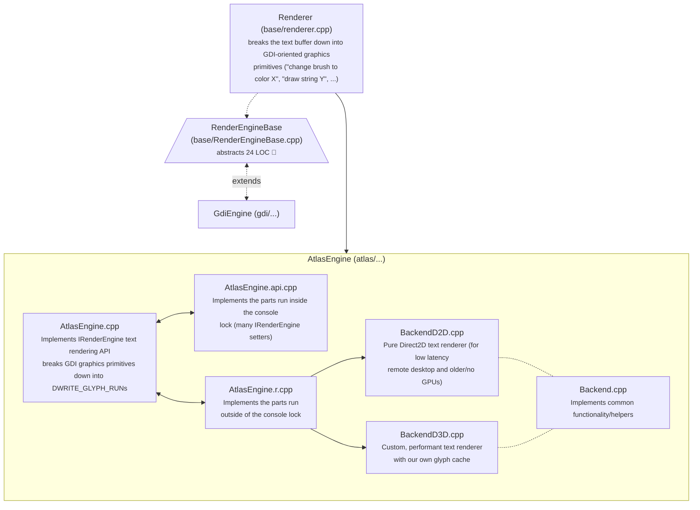
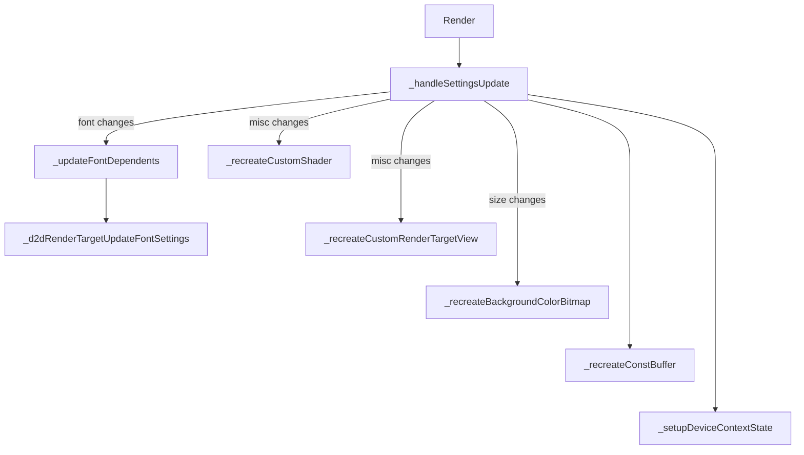
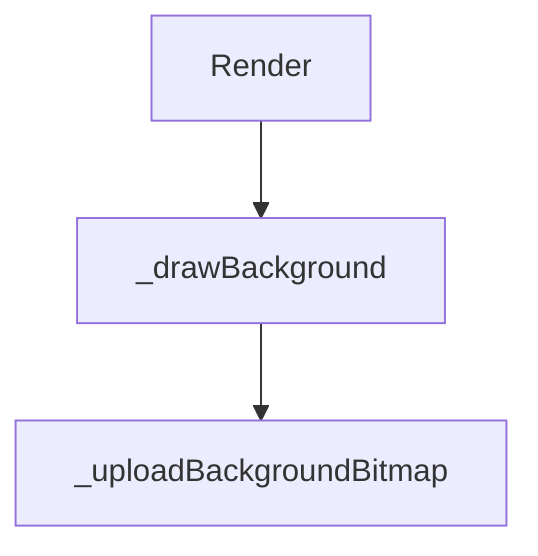
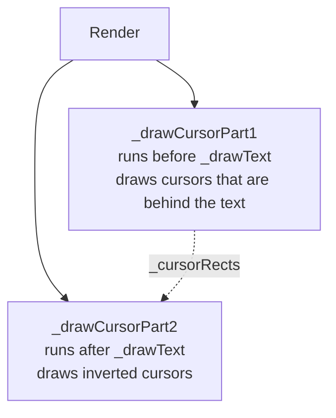
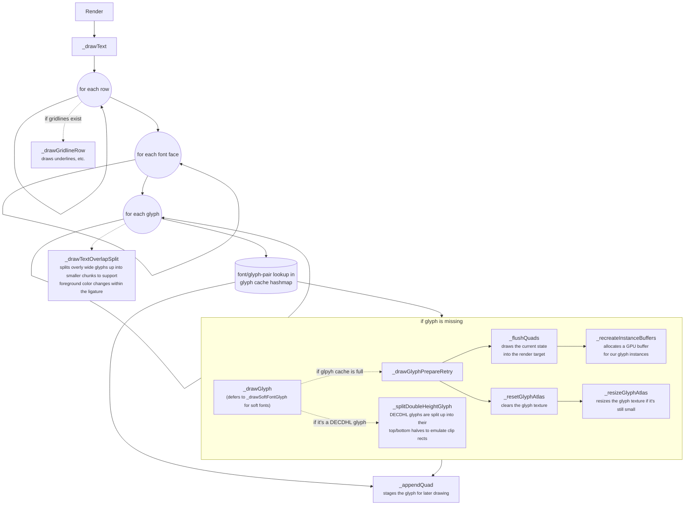
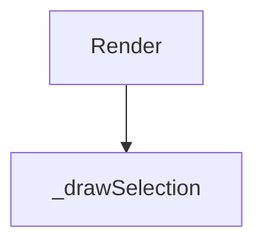
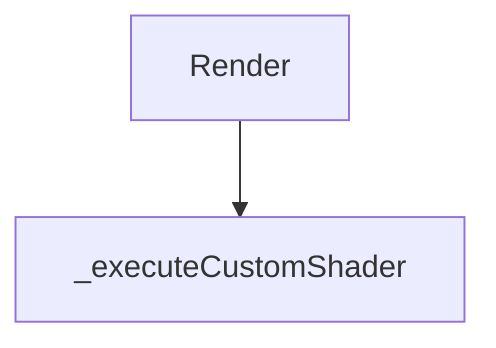

# AtlasEngine

## General architecture overview

As you can see, breaking the text buffer down into GDI-style primitives just to rebuild them into DirectWrite ones, is pretty wasteful. It's also incredibly bug prone. It would be beneficial if the TextBuffer and rendering settings were given directly to AtlasEngine so it can do its own bidding.

## Right-to-left text (Arabic, Hebrew, ...)

The terminal buffer stores text in logical order, one cell after another, but the backends draw a row's glyphs strictly from left to right.
`AtlasEngine::_flushBufferLine` bridges this gap for rows that contain right-to-left characters (all other rows take the regular path):

1. `_mapBidiBufferLine` runs `IDWriteTextAnalyzer::AnalyzeBidi` on the row and splits it into runs of equal bidi level.
   Box drawing characters are replaced with a strong left-to-right character for this analysis, so that the borders of a TUI end the bidi context and table columns don't swap places.
   The runs are then put into visual order (rule L2 of the Unicode Bidirectional Algorithm).
2. `_mapBufferLineRange` maps every run. Right-to-left runs are shaped with `isRightToLeft = true` (which is what makes Arabic letters join up), and their glyphs, colors and `FontMapping`s are reversed afterwards.
   The glyph offsets are negated, because `advanceOffset` is relative to the direction of the text.
3. `_mapComplex` fits right-to-left text into the grid one word at a time instead of one cluster at a time, to keep connected letters together.

Every run keeps the exact columns it occupies, so the rest of the row is unaffected. The selection and the background colors still operate on logical cells and are not mirrored. A vertical bar cursor is moved to where the next letter of a right-to-left run appears (`PaintCursor`, using `ShapedRow::rtlColumnRanges`).

Some applications, for instance Claude Code, assume a terminal without bidirectional text support and already write right-to-left text in its visual order. Reordering that text again undoes their work, so the mode is a per-window setting, the `BidiMode` registry value (a DWORD next to `UseDx`, in the window's `HKCU\Console\<title>` key):

| `BidiMode` | Meaning |
|---|---|
| `0` | Text is drawn in the order it's stored. |
| `1` (default) | The terminal reorders the text, as described above. |
| `2` | The text is already in visual order. `_mapVisualBufferLine` only joins up the letters: Every word of Arabic letters is reversed back (cell by cell, so that combining marks stay with their letter), shaped as right-to-left text, and the glyphs are put back into the cells they came from. |

With the default mode, the window switches to mode `2` by itself while an application that is known to reorder the text is attached to its console (currently `claude.exe`, see `BidiModeProvider` in `window.cpp`), and back when it exits. The engine asks for the mode at the start of every frame (`SetBidiModeProvider`) and redraws all rows when it changes. Rows that were written by such an application keep the visual order in the buffer, so they look wrong after it exits.

## BackendD3D

The primary entrypoint for rendering is `IBackend::Render` and `BackendD3D` implements it via the following functions, by calling them one by one in the order listed here.

### `_handleSettingsUpdate`

### `_drawBackground`

### `_drawCursorPart1` / `_drawCursorPart2`

### `_drawText`

### `_drawSelection`

### `_handleSettingsUpdate`

